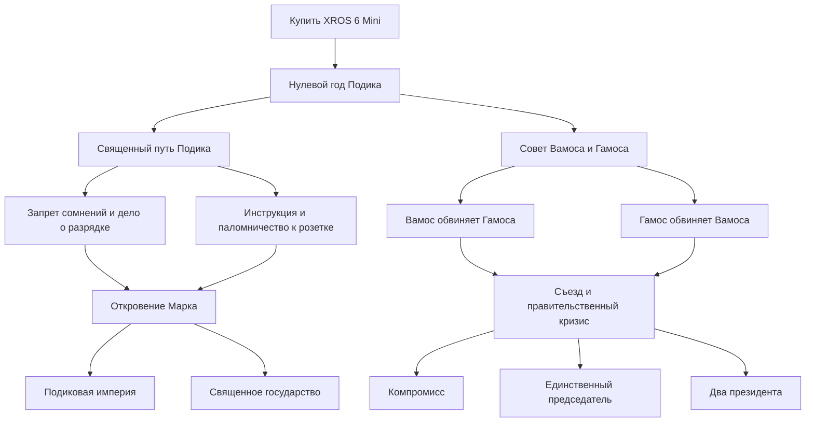

# kochmod

Мод для Hearts of Iron IV с десятью странами: Московская Администрация, Казанская Республика и Петергофское Княжество настроены, остальные пока остаются заготовками.

## Сценарий «Тучи над бурбулестаном сгущаются»

Начало: 1 января 2026 года, 12:00. Карта Земли сохранена. Отношения и войны пока не заданы. Регион 219 принадлежит Московской Администрации, 249 — Казанской Республике, 208, 244, 209 и 263 — Петергофскому Княжеству; остальные территории остаются пустыми.

### Петергофское Княжество (B02)

Владения, контроль и национальные территории: регионы 208, 244, 209 и 263. Столица — Петергоф, провинция 6174 с 30 победными очками в регионе 208. Правящая идеология — нейтралитет. Доли партий: демократия 0%, фашизм 40%, коммунизм 5%, нейтралитет 55%. Выборы отключены. Лидер — Чокмок I, технический подтип нейтралитета `despotism`; отдельного портрета пока нет.

Пользовательский флаг сохранён как `gfx/flags/B02.tga` (82×52), `gfx/flags/medium/B02.tga` (41×26), `gfx/flags/small/B02.tga` (10×7), исходник — `gfx/flags/source/koch_B02.png`. Обновлена историческая справка обеих закладок. Проверены партии, столица, все четыре владения и согласованность стратегической карты; запуск новой партии после этих изменений ещё не проверен.

### Казанская Республика (B04)

Регион 249 передан Казанской Республике как владение, контролируемая и национальная территория. Столица — Казань (провинция 6338, 30 победных очков). Правящая идеология — демократия; доли партий: демократия 65%, фашизм 5%, коммунизм 5%, нейтралитет 25%. Выборы разрешены. Лидер Астрандр добавлен через `common/characters/koch_B04.txt`; демократический подтип — `liberalism`, отдельный портрет пока не задан.

Флаг подготовлен из пользовательского изображения: `gfx/flags/B04.tga` (82×52), `gfx/flags/medium/B04.tga` (41×26), `gfx/flags/small/B04.tga` (10×7). Исходник сохранён в `gfx/flags/source/koch_B04.png`. Использован несжатый 24-битный TGA с сохранением композиции. В обеих закладках сценария выставлена демократия и обновлена историческая справка. Данные проверены по файлам; в игре изменения ещё не проверены. Новые армии, идеи и фокусы не добавлялись.

### Московская Администрация (B07)

Столица — Москва (регион 219, единственная провинция 6380). Прежний Московский регион разделён по существующим провинциям на Москву (219), Волоколамск (1082), Восточную Московскую область (1083) и Южную Московскую Область (1084). До гражданской войны все четыре принадлежат Московской Администрации, контролируются ею и являются её национальными территориями.

Правящая идеология — демократия. Поддержка партий: демократия 55%, фашизм 15%, коммунизм 5%, нейтралитет 25%. Выборы разрешены. Лидер — «Правительство Москвы»; для демократической роли используется технический подтип `liberalism`. Портрет взят из присланного изображения, подготовлен в DDS 156×210 без обрезки; исходный PNG сохранён в `gfx/leaders/B07`. В обеих закладках сценария указана демократия.

Флаг Московской Администрации подготовлен из присланного изображения в несжатом 24-битном TGA: `gfx/flags/B07.tga` (82×52), `gfx/flags/medium/B07.tga` (41×26) и `gfx/flags/small/B07.tga` (10×7). Исходник сохранён в `gfx/flags/source/koch_B07.png`. При уменьшении сохранена композиция, с полями цвета фона вместо обрезки. Общий флаг используется для всех идеологий, пока отдельные варианты не заданы. Цвет карты и интерфейса — RGB 168, 0, 44, взятый с бордового фона флага; он задан в определении страны и `common/countries/colors.txt`.

Для Московской Администрации добавлены персонажи, национальные духи и общее дерево выбора стороны гражданской войны; его текущая структура описана ниже. Население, ресурсы и здания региона сохранены из базовой карты. Изменения проверены по файлам; новая партия с этой страной ещё не запускалась. **Не запускайте `tools/clear-world.ps1`: он сбросит назначенное владение регионом.** Описание заготовок ниже относится к оставшимся девяти странам; B07 настроена согласно этому разделу.

### Заготовки стран

| Тег | Название |
| --- | --- |
| B01 | Чебоксарский Бурмалдат |
| B02 | Петергофское Княжество |
| B03 | Волжская коммуна |
| B04 | Казанская Республика |
| B05 | Самарская Народная Республика |
| B06 | Гомельские Болота |
| B07 | Московская Администрация |
| B08 | ИТМО |
| B09 | Наминальное Гродно |
| B10 | Анархия |

Теги зарегистрированы в `common/country_tags/koch_countries.txt`. Для каждого тега созданы определение `common/countries/koch_<TAG>.txt`, история `history/countries/<TAG> - koch.txt`, русская и английская локализация. В обеих закладках сценария основные страны идут в порядке B01, B02, B03, B04, B05, B07. Второстепенные интересные страны: B06 (Гомельские Болота), B08 (ИТМО), B09 (Наминальное Гродно), с параметром `minor = yes`. B10 (Анархия) существует в файлах мода, но исключена из записей выбора сценария. Автоматическая сортировка по ранее сыгранным странам отключена. Цвета предварительные. Нейтралитет — техническое начальное значение, а не утверждённая идеология. Названия пока одинаковы для всех идеологий; формы прилагательных также временно совпадают с названием.

Столицы, территории, флаги, портреты, персонажи, армии, идеи и собственные фокусы не добавлены. Используется ранее созданное пустое дерево по умолчанию. Для B06, B08 и B09 добавлено отдельное пустое техническое дерево `koch_minor_selection` с `default = no`: список второстепенных интересных стран отфильтровывает страны с общим деревом. Оценка выбора этого дерева равна 10 только для этих трёх тегов (у общего дерева — 1); само дерево не содержит ни одного фокуса. Исправление списка ещё не проверено визуально в игре. Без территорий страны пока не готовы к запуску полноценной партии. Скрипт `tools/create-country-stubs.py` сохраняет исходный перечень и отказывается перезаписывать существующие файлы.

После внутреннего конфликта, члены бурбулестана разделились на независимые государства, каждый имеет свои планы на бурбулестан и намерен его объединить. Также не спят и их внешние враги, которые намерены забрать ресурсы и богатства бурбулеков себе. Тучи сгущаются, и неизвестно, кто объединит эти земли под своим контролем...

Название и описание заданы в русской и английской локализации. Дата сценария и глобальная дата начала совпадают. Техническая дата окончания перенесена на 1 января 2050 года, чтобы она была позже старта; это не сюжетный срок. Отсчёт временного масштабирования мировой напряжённости также начинается в 2026 году. Изменения сценария требуют перезапуска игры.

Экран выбора сценария: HOI4 пропускает его при единственной закладке. Поэтому в файле сценария есть техническая копия с той же датой и описанием; в `interface/frontendgamesetupview.gui` она вынесена за видимую область увеличенным шагом сетки. Первая карточка отцентрирована, место для названия и описания расширено. После полного перезапуска игры сценарий должен показываться перед выбором страны. Этот экран после правки ещё не проверен в игре. При обновлении HOI4 нужно сверять переопределённый GUI с новой версией игры.

## Пустой мир

Регион 256 (Чебоксары) расширен: провинции 3383, 3224 и 6374 переданы из 252, а 3197, 3334, 345, 3269, 11373 и 6294 — из 250. В 256 теперь 18 провинций. Тридцать пять позиций объектов на этих территориях в `map/buildings.txt` перенесены в 256 с сохранением координат. Владельцы и параметры населения/экономики этим переносом не менялись. Проверено отсутствие повторного назначения провинций.

Исправлен вылет обычного запуска после расширения 256: он пересекал стратегические районы 40 и 133 (`MAP_ERROR` в отладочном логе). Провинции 3383, 3224, 6374 переведены из стратегического района 133 в 40 через переопределения двух файлов в `map/strategicregions`. Все 1081 региона проверены на принадлежность одному стратегическому району. Обычный запуск без `-debug` 10 октября 2026 года завершил загрузку в 12:50:28 (`Startup time: 39054ms`); логи сохранены в `tools/diagnostics/strategic-map-fixed`. При будущих переносах провинций нужно согласовывать не только историю регионов и позиции объектов, но и стратегические районы.

### Петергоф и границы регионов

Последующая правка: провинция 11068 передана из 208 в 244; семь позиций её объектов в `map/buildings.txt` также перенесены в 244. Регион 208 переименован из Луги в Петергоф. Город 11225 и регион 251 переименованы из Куйбышева в Самару. Эти названия заданы в `localisation/replace/koch_map_names_l_russian.yml` и английском файле, чтобы гарантированно переопределять локализацию базовой игры. Провинции 6174 и 79 остаются в 208. История первоначального переноса описана ниже.

Дополнительные города: Волоколамск (9302, регион 1082), Долгопрудный (6283, регион 1083) и Волжск (3315, регион 833). Долгопрудный и Волжск имеют по 10 победных очков; Волоколамск — 11, чтобы столица движения выбиралась в нём, а не в Подольске с 10 очками. Для новых городов добавлены русские/английские названия и городской тип местности. Чебоксары (9259) и Казань (6338) повышены до 30 очков. Значения проверены по всем файлам регионов; в игре эти изменения ещё не проверены.

Провинции 6174, 79 и 11068 перенесены из региона 195 в регион 208. В 195 остались 149 и 3151. Петергоф в провинции 6174 получил 30 победных очков, русскую/английскую локализацию и тип местности `urban` в переопределении `map/definition.csv`. Это крупнейшая отметка города в регионе 208 (Луга сохраняет 1 победное очко). В HOI4 у провинций нет собственного поля «столица»: Петергоф пока является главным городом региона, без назначения столицы государства. Регион 208 теперь принадлежит Петергофскому Княжеству; Петергоф назначен его столицей.

В `map/buildings.txt` перенесены в 208 двадцать семь позиций объектов, находящихся на трёх перенесённых провинциях. Их координаты сохранены. Число заводов, население и прочие общие параметры регионов не перераспределялись. Карта географически не перерисована. Скрипт `tools/prepare-peterhof-map.py` сохраняет способ создания переопределений и отказывается перезаписывать их. Эти изменения границ ещё не проверены запуском игры.

Карточка сценария использует `GFX_koch_burbulestan_2026` из `interface/koch_scenario.gfx`. Изображение с треснувшим флагом, огнём и картой с Самарой, Казанью, Чебоксарами и Волжском сохранено в `gfx/interface/scenarios`: исходный PNG и игровая текстура DDS размером 180×104. При уменьшении сохранена вся композиция без обрезки, с узкими боковыми полями. Оба bookmark используют одну текстуру.

В `history/states` находятся 1081 регион из установленной базовой игры. Из их истории удалены владельцы, контроль, национальные территории (cores), претензии и политические эффекты, включая датированные передачи территорий. Сохранены провинции, население, ресурсы, категории регионов, здания и победные очки, включая их прямые датированные изменения.

Через `replace_path` отключена стандартная загрузка тегов и определений стран, персонажей, истории стран и армий, общей истории, фокусов, решений, событий, on_actions и планов ИИ. Стандартные сценарии заменены одной заготовкой без выбранной страны. Географическая карта базовой игры используется без изменений.

Это основа для разработки, а не готовый игровой сценарий: заготовкам стран нужно назначить территории и столицы перед обычным запуском партии. Ванильные системы ещё содержат ссылки на отключённые стандартные страны и пишут ошибки в лог.

### Исправление вылета при загрузке

Нельзя оставлять `common/national_focus` полностью пустой. В `koch_default.txt` добавлено пустое дерево с `default = yes`, без игровых фокусов и привязки к стандартным странам. После одного этого изменения тестовый запуск 9 октября 2026 года прошёл прежнюю точку падения и завершил загрузку: в `setup.log` появилась строка `frontend.cpp: Startup time`. Прежние диагностические логи сохранены в `tools/diagnostics/before-fix`. Ссылки других ванильных систем на удалённые страны остаются отдельной задачей; запуск полноценной партии без стран не проверялся.

Проверено двумя запусками: с `-debug` (загрузка завершилась в 23:12:17) и без отладки (в 23:14:14, `Startup time: 41130ms`). Логи второго запуска сохранены в `tools/diagnostics/verified-normal-start`. Нового отчёта о вылете при проверке не появилось. Все 1081 регион по-прежнему не имеют владельцев, контроля, cores и претензий.

Скрипт `tools/clear-world.ps1` повторно создаёт очищенные регионы из установленной игры. **Он перезаписывает одноимённые файлы регионов мода**: после начала ручной работы с картой не запускайте его без резервной копии.

## Структура

| Папка | Содержимое |
| --- | --- |
| `common/countries` | Цвета и графические настройки стран |
| `common/country_tags` | Теги стран |
| `common/characters` | Лидеры, советники и командиры |
| `common/national_focus` | Деревья национальных фокусов |
| `common/ideas` | Национальные духи и идеи |
| `common/decisions` | Решения и категории решений |
| `common/technologies` | Технологии |
| `common/units` | Типы войск и оборудование |
| `common/scripted_effects` | Переиспользуемые эффекты |
| `common/scripted_triggers` | Переиспользуемые условия |
| `common/on_actions` | Обработчики игровых действий |
| `events` | События |
| `history/countries` | Начальные настройки стран |
| `history/states` | Регионы, владельцы, ресурсы и здания |
| `history/units` | Начальные армии и флоты |
| `localisation/russian` | Русская локализация |
| `localisation/english` | Английская локализация |
| `gfx/interface` | Иконки и изображения интерфейса |
| `gfx/leaders` | Портреты |
| `gfx/flags` | Флаги |
| `interface` | Описания интерфейса и спрайтов |
| `map` | Файлы карты |
| `music` | Музыка |
| `sound` | Звуки |

## Запуск

В `descriptor.mod` находятся настройки мода и директивы `replace_path`. В родительской папке `mod` находится `kochmod.mod` с путём к этой папке; его директивы `replace_path` должны совпадать с `descriptor.mod`.

Добавьте мод `kochmod` в игровой набор в Paradox Launcher. Для проверки используйте отдельный набор без других модов и новую игру: существующие сохранения содержат прежние страны и владельцев.

## Правила файлов

- Давайте новым файлам и ключам префикс `koch_`, чтобы уменьшить вероятность конфликтов с другими модами.
- Локализацию сохраняйте в UTF-8 с BOM: например, `koch_l_russian.yml` с первой строкой `l_russian:` и `koch_l_english.yml` с первой строкой `l_english:`.
- Не копируйте все файлы базовой игры: добавляйте только нужные для конкретного изменения.
- После изменений проверяйте `logs/error.log` в пользовательской папке Hearts of Iron IV.
- Пустые папки Git не сохраняет; при использовании Git они появятся в репозитории после добавления файлов.

### Московская гражданская война

В новой кампании у Московской Администрации открыто дерево `KOCH_moscow_shared_tree`. Центральный фокус «На пороге раскола» (35 дней) вызывает событие «Чью сторону мы примем?». Выбор автоматически завершает один из трёх взаимоисключающих фокусов: «Защитить Администрацию», «Волоколамский Орден» или «Имперская Армия». Напряжённость начинается с 50% и растёт на 1 процентный пункт каждые 3 дня независимо от выбора стороны. Выбор демократов однократно снижает её на 15 пунктов; при 0% кризис разрешается, при 100% начинается трёхсторонняя война. Оригинальная B07 остаётся демократической. Фашистская сторона создаётся единственным вызовом `start_civil_war`, авторитарная — через `create_dynamic_country` с копированием B07 и передачей регионов во владение. Все три стороны воюют друг с другом; войны с третьей стороной зарегистрированы через `add_civil_war_target`. Существующие дивизии распределяются по довоенным долям сил, новые не создаются. Вандерс переходит к фашистам, Калинкин — к авторитаристам; «Правительство Москвы» остаётся у демократов. Выборы у обеих повстанческих сторон отключены. Псевдонимы тегов `KMF` и `KMA` (`common/country_tag_aliases/koch_moscow.txt`) находят потомков B07 по уникальным флагам.

После успешного создания трёх сторон и настройки войны открывается глобальный суперивент «Раскол Московской Администрации». Обычная новость `koch_moscow_crisis.3` удалена; подробности оформления и автозакрытия описаны ниже.

Регионы сторон передаются во владение вместе с контролем: демократы — 219, 1083, 248, 253; Волоколамское движение — 1082 и 247; Имперская Армия — 1084, 205, 223, 254. Столица Администрации — Москва (6380 в регионе 219), движения — Волоколамск (9302 в регионе 1082); имперская столица остаётся в Туле. Прежний эффект начальной оккупации провинций полностью удалён: исходные границы сторон теперь совпадают с границами принадлежащих им регионов.

Все четыре московских региона используют отдельную категорию `koch_moscow_district` с 25 базовыми ячейками строительства; ванильные категории не меняются. Москва: 2 военных завода, 3 фабрики, инфраструктура 4 (5/25 ячеек). Волоколамск: 2 военных завода, 1 фабрика, инфраструктура 3 (3/25). Восточная область: 1 военный завод, 2 фабрики, инфраструктура 3 (3/25). Южная область: 2 военных завода, 2 фабрики, инфраструктура 3 (4/25). Указанные пользователем 5/25 для Южной области исправлены на 4/25 по сумме заданных предприятий. «Юго-Восточная» в распределении сторон истолкована как эта же Южная область. По последующему уточнению пользователя железные дороги и логистические узлы сохранены без изменений: файлов-переопределений `map/railways.txt` и `map/supply_nodes.txt` нет.

Все 25 провинций и пять городов прежнего региона сохранены. Общие население 8 335 992, сталь 16, уголь 16 и местное снабжение 6 распределены между четырьмя регионами; Москва получила 4 000 000 населения, остаток распределён по числу провинций областей. Исходный аэродром уровня 10 сохранён в Южной области по его прежнему положению у Домодедово; Кремль остался в Москве, исследовательский центр — в Подольске (Волоколамский регион). Все 98 исходных позиций моделей зданий сохранены и перепривязаны к новым регионам по карте провинций. Добавлены недостающие позиции моделей для отдельных регионов. Сборка и проверки: `output/diagnostics/moscow-state-split/build_states.py`, `validate_states.py`; параметры и принятые исправления — `states.json`. Требуются полный перезапуск HOI4 и новая кампания: старые сохранения не содержат новых регионов.

После создания стран, назначения лидеров, объявления войн и распределения контроля провинций вызывается `KOCH_B07_assign_civil_war_focus_paths`. Все стороны получают одно дерево: общий завершённый прогресс копируется до изменения пути B07, унаследованные чужие ветки очищаются вместе с дочерними фокусами, собственная ветка и её изученные фокусы сохраняются, а каждому государству завершается его собственный корень. Демократам открывается только демократическая ветка, Ордену — ветка Ордена, Имперской Армии — имперская; чужие ветки скрываются через `allow_branch`. Выбор игрока сохранён отдельным флагом: человек переходит к `KMF` или `KMA` только после полной настройки войны, а выбор демократов оставляет его в B07. Если игрок не выбрал сторону до начала войны, он остаётся за демократов. Даже без изученного центрального фокуса все три страны получают завершённый общий фокус и собственный корень ветки; событие выбора после раскола не вызывается, а запоздалый ответ не меняет пути стран. Для ИИ переключения игрока нет. Повторная настройка и запуск таймера защищены флагами. Если администрация теряет необходимые регионы до конца отсчёта, появляется событие об отмене прежнего плана.

Категория использует штатную иллюстрацию `GFX_decision_cat_picture_soviet_civil_war`. Демократическая Московская Администрация сохраняет довоенный бордовый цвет RGB (168, 0, 44). Волоколамский Орден (фашисты) имеет почти чёрный серо-синий цвет RGB (18, 24, 32), Имперская Армия (авторитаристы) — тёмно-зелёный RGB (0, 50, 0). Проверка: `tools/validate-moscow-civil-war.py`; схема разделения — `tools/diagnostics/moscow-civil-war/partition-preview.png`. Статические проверки прошли; переход по таймеру и трёхсторонняя война в игре ещё не проверены.

### Беспорядки в Подольске

В провинции 3391 сохранён город Подольск с 10 победными очками; теперь он находится в Волоколамском регионе 1082. 25 января 2026 года Московская Администрация, если ещё владеет этим регионом, получает событие об уничтожении исследовательского центра наземной войны во время фашистских протестов. Единственный уровень `land_facility` удаляется в провинции 3391, а инфраструктура региона 1082 снижается на 1 при срабатывании события, независимо от времени нажатия кнопки. Ежедневная проверка ограничена этой датой, а флаг и `fire_only_once` защищают от повторения. Иллюстрация — `GFX_report_event_generic_riot`.

### Исправление вылета при запуске времени

Отчёт `hoi4_20261011_023454` содержит `EXCEPTION_STACK_OVERFLOW`. Обработчики смены правительства и правящей партии повторно вызывали `set_politics` через `KOCH_update_moscow_elections`, создавая рекурсию. Эффект теперь меняет настройки только при несовпадении разрешённых выборов с текущей идеологией и защищён временным флагом от повторного входа. Флаг устанавливается до `set_politics` и снимается после завершения. Исправлен также неверный синтаксис `remove_dynamic_modifier` у казанского национального духа.

`tools/validate-election-callbacks.py` исполняет используемую часть настоящего скрипта в модели с обратными вызовами до и после применения настроек: 32 случая проверяют завершение, сохранение идеологии, отсутствие повторных изменений и очистку флага. Сохранённый старый скрипт воспроизводит рекурсию в этой модели. Диагностика — `tools/diagnostics/time-start-crash/`. Это проверка скриптов, а не запуск игрового движка; после изменения файлов требуется перезапуск игры.

Проверка ссылок на повстанческие страны: `tools/validate-moscow-war-targets.py` исполняет завершающую часть настоящего скрипта в модели без локальных целей событий. При трёх разных наборах динамических тегов проверены оба лидера, три пары гражданских войн и контроль 20 провинций. Это проверка скрипта, а не игрового движка. Для повторной проверки начала войны после перезапуска игры можно загрузить сохранение до истечения 90-дневного отсчёта.

Флаги восставших сторон импортированы из изображений пользователя: Волоколамский Орден — `gfx/flags/source/KOCH_MOSCOW_FASCISTS.png`, Имперская Армия — `gfx/flags/source/KOCH_MOSCOW_AUTHORITARIANS.png`. Для каждого косметического тега подготовлены несжатые 32-битные TGA 82×52, 41×26 и 10×7, базовый вариант и вариант для правящей идеологии. Все изображения непрозрачные, исходники сохранены без изменений.

### Фокусы выбора стороны

В московском дереве остаются четыре фокуса: «На пороге раскола», «Волоколамский Орден», «Защитить Администрацию» и «Имперская Армия». Центральный фокус изучается 35 дней и вызывает событие выбора стороны. Три взаимоисключающих корня завершаются через выбор в событии. Демократический выбор однократно продлевает довоенный таймер на 30 дней. После начала войны каждая сторона получает свой завершённый корень, а игрок переходит к выбранной стороне. Последующие 36 фокусов каркаса и их локализация удалены. Корень Ордена использует `GFX_goal_support_fascism`, корень Имперской Армии — `GFX_focus_rom_royal_dictatorship`; расположение четырёх оставшихся фокусов сохранено.

### Общие политические действия

Для всех стран восстановлена стандартная категория `political_actions` со штатными иконками и локализацией игры: 4 вида рейдов против оппозиции, 4 запрета партий, 4 варианта цензуры прессы, улучшение рабочих условий и ядерная гонка (14 решений). Цены, длительность и модификаторы соответствуют установленной версии HOI4. Действия появляются и становятся доступны по обычным условиям: идеология правительства, популярность оппозиции, стабильность или развитие ядерной программы. Для действий против авторитаристов снята привязка к ванильному общему дереву, поэтому они работают с деревьями мода и у динамических стран гражданской войны. Исключения для конкретных ванильных стран и их фокусов не подключены.

Файлы: `common/decisions/koch_political_actions.txt` и категория в `common/decisions/categories/koch_political_actions.txt`; глобальная замена каталога решений сохранена. Для завершения ядерной гонки восстановлены только необходимые стандартные события `generic.8`, `generic.9`, `generic.10` и обработчик первого ядерного удара: остальные ванильные события остаются отключены. Генератор — `tools/create-generic-political-actions.py`, проверка — `tools/validate-political-actions.py` (14 решений и 260 сценариев доступности). В движке ещё не проверено.

При начале московской гражданской войны восемь стартовых дивизий при исходных долях 25/37,5/37,5% распределяются как 2/3/3. Если решения изменили доли сторон, распределение пересчитывается по ним с сохранением общего числа частей. Дивизии передаются из существующей армии; новые не создаются. Распределение запасов, авиации и флота сохранено через значения `size`.

Начальная расстановка после разделения армии и передачи регионов проходит по реальным сухопутным границам сторон. Администрация использует 16 приграничных провинций, Волоколамское движение и Имперская Армия — по 12. Первые позиции выбираются ближе к центральному городу, затем обеспечивается присутствие против обоих противников и заполнение удалённых участков фронта. При нехватке частей занимаются первые позиции; при избытке выполняются повторные проходы по всем приграничным провинциям, поэтому численность гарнизонов позиций отличается не более чем на одну дивизию. Части в тыловых сборных точках не остаются. Это однократная расстановка при начале войны, до переключения игрока и суперивента; последующие перемещения определяются игроком и ИИ.

Эффект `common/scripted_effects/koch_moscow_army_positions.txt` сохраняет существующие дивизии и распределяет их по довоенному соотношению сил. Дополнительные дивизии при расколе не создаются. Расстановку на границах выполняет `common/scripted_effects/koch_moscow_frontline_positions.txt`. Две временные страны последовательно удерживают резерв и одну перемещаемую дивизию; для передачи войск им необходима территория. На время исполнения этого эффекта резерв получает регион 253, транзит — 205; после возврата всех частей регионы возвращаются B07 и Имперской Армии соответственно, затем временные теги освобождаются. Обе передачи выполняются в одном скрипте до переключения игрока и объявления суперивента. Регионы 248, 247 и 223 используются только для промежуточного сбора войск; конечные назначения всех дивизий находятся на границе. Проверка модели требует существования обеих стран при каждом `transfer_units_fraction`, полного возврата территорий и очистки временных стран. В работающем движке исправление ещё не проверено.

Список границ строится из общей границы пикселей провинций в действующей `provinces.bmp`, распределения десяти регионов и запретов прохода из `adjacencies.csv`. Генератор — `output/diagnostics/moscow-frontlines/build_frontlines.py`, список соседей и порядок назначения — `frontlines.json`, схема первых пяти позиций каждой стороны — `preview.png`. Проверка `validate_frontlines.py` подтверждает владение каждой точкой, наличие соседнего противника, полноту покрытия и правильные исходные регионы для `teleport_armies`. Проверка армии `output/diagnostics/moscow-balance/validate_balance.py` прошла для 96 вариантов: сохранены все исходные части и их доли, включая нулевую армию и избыток дивизий, все конечные позиции приграничные. Для применения нужны перезапуск игры и сохранение до начала войны.

Исправление 18 октября 2026: в журнале игры обнаружены ошибки загрузки этой расстановки: `Invalid effect 'MINIMUM'`, `SIDE`, `STAGING_STATE`, `PROVINCE` и неразобранные `$STAGING_STATE$`. Блоки параметров заменены обычными вызовами scripted effects через `= yes`, числовые области регионов и назначения провинций указаны явно. Текущая сторона сохраняется в глобальную цель события, которая очищается вместе с целями резерва и транзита. Проверка `output/diagnostics/army-placement-fix/validate_positions.py` исполняет настоящий скрипт в модели для пяти вариантов начального числа дивизий, включая отсутствие частей и избыток: проверены все 17 назначений, сохранность исходных дивизий, возврат избытка и очистка временных стран. Это не проверка игрового движка. Для проверки в игре требуется перезапуск HOI4 и сохранение до начала гражданской войны. Копия прежнего скрипта сохранена рядом как `before.txt`.

### Соотношение сил московского кризиса

Доли сил инициализируются как 25% / 37,5% / 37,5% для демократов, Ордена и Имперской Армии. Они отображаются в категории кризиса вместе с выбранной стороной и числом переманенных генералов. После выбора стороны через существующий фокус доступны решения «Переманить офицеров на свою сторону» и «Переманить генерала»: каждое стоит 50 политвласти и выполняется 30 дней. Только после завершения даёт выбранной стороне 5 процентных пунктов за счёт соперников; затем его можно запустить повторно без дополнительного ожидания. При завершении кризиса подготовка отменяется без применения бонусов. Выбранная сторона получает ровно +5 процентных пунктов, а каждая другая теряет ровно 2,5 пункта; сумма остаётся 100%. Действие доступно, только если у каждого соперника осталось не менее 2,5%, и повторно проверяет это условие по завершении.

Для генерала требуется случайный действующий командир корпуса Администрации без прежней присяги. Решение помечает его характерным флагом; до раскола он остаётся в B07, после создания всех трёх сторон передаётся выбранной стороне через `set_nationality`. Двойное переманивание исключено. При отсутствии подходящих генералов решение недоступно; новых генералов оно не создаёт. При мирном урегулировании командир остаётся в Администрации.

Перед войной фиксируется общее число дивизий. `KOCH_B07_calculate_army_shares` распределяет целые дивизии методом наибольших остатков; например, исходные 8 частей делятся как 2/3/3. При равных остатках приоритет у демократов, затем у Ордена. Армия временно собирается в резерве и передаётся по рассчитанным числам без создания или удаления частей. Запасы, авиация и флот сохраняют прежний раздел. Инициализация долей поддерживает старые довоенные сохранения на первом суточном обновлении, не сбрасывая уже накопленное влияние.

`output/diagnostics/moscow-balance/validate_balance.py` исполняет настоящие эффекты и условия в модели. Проверены блокировка влияния до выбора фокуса и после завершения кризиса, приросты и пределы всех трёх долей, 96 сочетаний размеров армии и усиления сторон, сохранение дивизий и их расстановка, отсутствие повторных присяг и передача генералов всем трём сторонам. Это проверка модели, а не игрового движка; для проверки в игре необходимы перезапуск HOI4 и сохранение до начала войны.

### Глобальный суперивент: начало московской гражданской войны

После создания трёх сторон, размещения армий и переключения игрока на выбранную сторону эффект `KOCH_B07_start_three_sided_war` устанавливает глобальный флаг `KOCH_moscow_civil_war_superevent_started`. Прежний вызов и определение новости `koch_moscow_crisis.3` удалены. Независимый интерфейс `common/scripted_guis/koch_moscow_superevent.txt` с контекстом `player_context` показывает всем игрокам окно `interface/koch_moscow_superevent.gui`, центрированное на экране (592×478, примерно в 1,5 раза меньше прежнего 888×716). Окно можно передвигать. Кнопка «Москва в огне» закрывает его досрочно в текущей стране и не скрывает у остальных. Скрытые события `koch_moscow_crisis.4` и `.5`, назначенные всем существующим странам при объявлении войны, автоматически закрывают окно у ИИ через 5 игровых дней, а у всех через 10 игровых дней. Отсчёт общий от объявления, зависит от скорости игры и останавливается на паузе. Флаги закрытия стран сохраняются при смене страны в spectator; глобальные флаги истечения сроков также скрывают окно для стран, созданных позднее. Автозакрытие не требует нажатия кнопки ИИ. Кнопки X и горячей клавиши нет.

В окне использована исходная сцена `gfx/interface/superevents/koch_moscow_civil_war.png`; для текущего оформления используется производный DDS `koch_moscow_civil_war_panel.dds` 570×392 с центральным кадрированием под высокую область фотографии; исходник сохранён. Заголовок «Раскол Московской Администрации», цитата и подпись «- Цицерон.» взяты из запроса пользователя. Оформление повторяет предоставленный образец: тонкая тёмная рамка, чёрная верхняя плашка с белым заголовком, фотография на основную площадь окна, белая цитата и подпись справа на полупрозрачной чёрной подложке поверх фотографии и узкая чёрная кнопка снизу. Рамка, плашки и кнопка подготовлены кодом как отдельные DDS-текстуры; основной текст использует штатные шрифты HOI4. Изолированный шрифт заголовка `KOCH_superevent_title` использует Aldrich Regular для латиницы и согласованную пользователем близкую по стилю Jura Medium для кириллицы: оригинальный Aldrich кириллицы не содержит. Исходные TTF и лицензии SIL OFL сохранены в `gfx/fonts/source/`. Общие шрифты и глобальная палитра не переопределяются. Подложка цитаты теперь прозрачна вне её строк и подписи, без большой пустой затемнённой области слева. Русская и английская локализация находятся в `koch_moscow_superevent_l_*.yml`.

Звук запускается глобальным документированным эффектом `sound_effect = KOCH_moscow_civil_war_superevent_audio` в момент объявления войны, в одном блоке с установкой глобального флага суперивента и под защитой этого флага от повторения. `show_sound` у окна удалён: пересоздание GUI при переходе за Волоколамское движение или Имперскую Армию больше не запускает ещё одну дорожку. `sound/koch_moscow_superevent.asset` относит эффект к категории UI и связывает его с предварительно загруженным образцом `KOCH_moscow_civil_war_superevent_sample`. WAV `koch_moscow_civil_war_superevent.wav` сохранён: исходный пользовательский MP3 обрезан с 0:50 до 1:30, ровно 40 секунд PCM 16 bit / stereo / 44100 Hz. Первые 30 секунд фрагмента сохранены без изменений; последние 10 секунд (1:20–1:30 исходника) имеют линейное затухание до нулевого последнего семпла. Звук воспроизводится в реальном времени; его окончание не закрывает окно.

Диагностика расположена в `output/diagnostics/moscow-superevent/`: `preview.png` показывает текущее оформление с русскими растровыми шрифтами; `build_layout.py` пересобирает текстуры и предпросмотр по исходной фотографии; `assets.json` фиксирует источник, его SHA-256 и параметры обработки; `audio_validation.json` содержит проверку затухания по сравнению с исходным фрагментом; `text_layout.json` проверяет ширину надписей. `validate_superevent.py` проверяет связи GUI/спрайта/звука, локальное закрытие глобального сообщения, сроки 5/10 игровых дней, поведение при смене и создании стран, отсутствие прежней новости, формат аудио и текстовые ресурсы. Модель исполняет условия видимости и эффекты скрытых событий из файлов мода. Проверки ресурсов и модели прошли; игровой движок не запускался. Для проверки в игре необходим перезапуск HOI4 и довоенное сохранение: уже открытый суперивент в старом сохранении не получит новые отложенные события.

Исправление отсутствия музыки: журнал содержал `Missing sound effect: KOCH_moscow_civil_war_superevent_audio`. Ранее был объявлен только образец `sound`, хотя `show_sound` ищет запись `soundeffect`. Добавлена необходимая связка `soundeffect -> sounds -> sound`, без изменения WAV или пользовательских настроек громкости. Проверка `validate_superevent.py` теперь требует именно эту связку, а не только наличие аудиофайла и совпадение имени. Воспроизведение относится к звуковым эффектам интерфейса. Для загрузки новых ресурсов необходим полный перезапуск игры; прослушивание в самом движке ещё не проверено.

Последующее исправление 18 октября 2026: регион 1083 переименован в «Восточная Московская область» / «Eastern Moscow Oblast», его ID и провинции сохранены. В журнале запуска 20:57 и начала войны 21:00 подтверждены `Invalid effect 'while'` в расчёте долей и распределении армии, а также `transfer_units_fraction: non existing countries` при обращении к прежним странам без территории. Все четыре цикла заменены на документированный `while_loop_effect`; временные страны получают и возвращают территории, как описано выше. Прежняя проверочная модель этих ограничений не учитывала; теперь она отвергает старую передачу в страну без территории и проверяет возврат регионов для всех 96 сценариев распределения. Устранено предупреждение об отсутствии категории звука. Дублирование дорожки исключено переносом воспроизведения из GUI в однократное объявление; проверки моделируют повтор объявления при всех трёх вариантах страны игрока. Исходные ошибки сохранены в `output/diagnostics/moscow-conflict-fix/engine-errors-before.txt`, сверка названий эффектов с документацией установленной игры и воспроизведение прежнего сбоя модели — в `validate_runtime_contracts.py`. Исправления проверены статически и в модели, без нового запуска движка. Для применения нужны перезапуск игры и сохранение до начала войны; после смены карты нужна новая кампания.

## Древо Подиковой республики
# Подиковая республика: реализация и проверка

Страна B11, столица в регионе 66; дипломатический партнёр — существующая B09, Гродненская республика президента Артура Круглого. Теги, территории, флаги и портрет Марка сохранены. Дерево содержит **101 фокус**, **101 событие**, **53 национальных духа**, **33 решения** в **6 категориях** и **6 модификаторов отношений**. Нужна новая партия, чтобы применились начальные технологии, персонажи и переменные.

## Политическая история

Старт: последнее здравомыслие → розыск Подика → чрезвычайный кабинет → кризис бюджета → покупка XROS 6 Mini → новая эпоха. Покупка даёт дух, переменную заряда, решения и отдельное историческое событие. Продолжительность фокусов — 7, 14, 21, 35 или 70 дней: `cost` в HOI4 измеряется неделями.

Культ и Совет строго взаимоисключаются. Культ делает Марка хранителем святыни, меняет правящую партию и отменяет выборы. Совет передаёт власть коллективному руководству и также меняет политический строй.

В культе оба ранних направления — религиозное и хозяйственное — нужны для объединения народа. Затем запрет сомнений исключает техническую инструкцию. Обе развилки сходятся у испарительной революции. Для назначения штатного пророка нужно признать откровение; отказ можно пересмотреть через повторное событие. Империя и верховенство Подика исключают друг друга.

В Совете нужно выслушать обоих председателей. Взаимные обвинения образуют альтернативную развилку; съезд доступен после любого обвинения. После кризиса выбирается ровно один из трёх финалов. Единоличное кресло требует не менее 65% влияния у одного председателя; лидером становится именно он.

| Финал | Изменения и возможности |
| --- | --- |
| Подиковая империя | Новое название, имперский дух, военное снабжение и цели войны против независимых соседей вне своего альянса. Дружественное Гродно исключено. |
| Священное государство | Новое название, устойчивость режима, священные собрания за политическую власть и заряд. |
| Великий компромисс | Прекращение борьбы влияний и саботажа, баланс 50/50, гражданские строительные контракты. |
| Единственный председатель | Вамос или Гамос становится реальным лидером, влияние 100/0, прекращение соперничества, военные производственные распоряжения. |
| Два президента | Коллективный лидер, новые бонусы и президентские смены; влияние и риск саботажа сохраняются. |

## Заряд и борьба за влияние

`KOCH_podik_charge` ограничен диапазоном 0–100 и меняется ежедневно. Базовый расход — 0,5 пункта в сутки, после инструкции — 0,3. Война добавляет 0,2, экономрежим уменьшает расход на 0,2 (минимум 0,1). Экономрежим стоит 10 политической власти при включении и даёт небольшие штрафы авторитета и поддержки войны; выключается бесплатно.

| Заряд | Состояние |
| --- | --- |
| От 90% | Золотой век: бонусы стабильности и строительства |
| 40–89,9% | Нормальная работа |
| 20–39,9% | Предупреждение и небольшой штраф политической власти |
| Ниже 20% | Кризис доверия; для восстановления порядка требуется 40% |
| 0% | Полное отключение: усиленный штраф вместо обычного кризиса |

Ручная зарядка стоит 20 политической власти, длится до трёх ежедневных обновлений и восстанавливает по 20 пунктов за обновление или по 30 после инструкции. Расход на время зарядки приостановлен, повторное подключение во время зарядки недоступно. При достижении 100% процесс завершается досрочно. Интервал между ручными заказами — 21 день. Срочная замена картриджа за 60 политической власти сохраняет немедленное восстановление 100% при заряде ниже 25%.

После инструкции можно назначить дежурного за 60 политической власти. Служба стоит 0,15 политической власти в день и автоматически начинает зарядку ниже 35%, без повторной оплаты каждого цикла. Службу можно отключить бесплатно; текущий цикл завершится. Повторная организация службы снова требует 60 политической власти. Поломки и пропажи автоматика не устраняет.

В панели решений показываются заряд с десятичной частью, состояние, режим, текущий расход, обслуживание и примерный срок до отметки 20%. Во время зарядки вместо прогноза показывается оставшееся время. До выбора культа расход не действует; Совет не использует эту механику. Предупреждение ниже 40% повторяется только после восстановления хотя бы до 60%, кризис — после выхода на 40%, отключение — после восстановления хотя бы до 20%.

Раз в месяц возможны редкие пропажа или поломка: по 3%, с общим перерывом 180 дней после происшествия. При происшествии заряд обнуляется, текущая зарядка прекращается. Розыск, срочный и прямой ремонт и покупка замены сохранены. Недоступное устройство нельзя зарядить ни вручную, ни автоматически; поздний результат розыска не сбрасывает заряд уже заменённого устройства.

`KOCH_vamos_influence` и `KOCH_gamos_influence` всегда дают в сумме 100. Решения поддержки меняют баланс на 10 пунктов, события могут менять его сильнее. При влиянии одного председателя не менее 75% ежемесячная проверка вызывает саботаж второго. Игрок может оплатить восстановление 50/50, переждать 90 дней остановок или уступить часть влияния с 30 днями ограниченного саботажа. Компромисс и единоличное правление прекращают эту механику; двоевластие сохраняет её. Отдельный редкий скандал возможен раз в месяц с вероятностью 6% и перерывом 180 дней.

## Артур и хозяйственная ветка

Дружба и конфронтация взаимоисключаются. Точное название **«Охранять туз Артура»** сохранено. Сначала предложение получает Артур; без его согласия охрана и дальнейшие договоры не открываются. Финансирование повышает шанс согласия ИИ. Отказ можно пересмотреть новым предложением через решения.

После согласия доступны взаимные гарантии, братство, хозяйственный саммит и предложение альянса. Союз требует независимости и совместимых обязательств; сначала создаётся фракция, затем в неё добавляется B09. Отказ Артура или несовместимые обязательства оставляют гарантии и возможность повторить предложение. Культ и Совет отличаются текстами, стоимостью ритуальной дипломатии и шансом одобрения союзного договора.

Конфронтация ухудшает отношения и запускает ультиматум с ответом Артура. После отказа можно отдельно получить цель войны за 75 политической власти либо примириться. Автоматического объявления войны нет. Успешные переговоры снимают пограничную горячку; следующий фокус не возвращает её после закрытия спора. При отсутствии B09 дипломатические фокусы недоступны, адресные эффекты защищены проверками существования страны.

Хозяйственная ветка зависит от новой эпохи и выбора политического курса, поэтому отсутствие Гродно не блокирует развитие. Она даёт логистику, завод, реальные ополчение и шаблон дивизии, опыт армии, пропаганду, исследовательскую группу и итоговый государственный дух. Культ получает строительные программы и заряд, Совет — производственные контракты и политическую власть. Ранние награды ограничены: несколько заводов и небольшое ополчение вместо мгновенной сверхдержавы.

Политика размещена слева и в центре, дипломатия — правее, хозяйственная колонка вынесена ещё дальше вправо, чтобы её длинная входящая связь не проходила через дипломатический корень. Панель непрерывных фокусов находится на `y = 3000`, ниже всего дерева. Использованы существующие тематические иконки HOI4. Вамос и Гамос используют разные базовые гражданские портреты; коллективный портрет Совета собран из этих же изображений.

## Файлы

| Файл | Назначение |
| --- | --- |
| `common/national_focus/koch_podik.txt` | 58 фокусов, координаты, условия, финалы и награды |
| `events/koch_podik.txt` | 50 сюжетных, дипломатических и кризисных событий |
| `common/ideas/koch_podik.txt` | 36 духов |
| `common/decisions/koch_podik.txt` | 25 решений, включая адресный имперский мандат |
| `common/decisions/categories/koch_podik.txt` | 4 категории и счётчики переменных |
| `common/scripted_effects/koch_podik.txt` | Инициализация, заряд, влияние, альянс и переходы власти |
| `common/on_actions/koch_podik.txt` | Стартовые, ежедневные и ежемесячные обработчики |
| `common/scripted_localisation/koch_podik.txt` | Состояние, режим, обслуживание и прогноз заряда |
| `common/opinion_modifiers/koch_podik.txt` | 6 дипломатических модификаторов |
| `common/country_leader/koch_podik_traits.txt` | Черты хранителя и пророка |
| `common/characters/koch_B11.txt` | Марк, Совет, Вамос и Гамос |
| `history/countries/B11 - koch.txt` | Начальные технологии, исследования, персонажи и кризис |
| `history/units/KOCH_B11_militia.txt` | Шаблон и дивизия ополчения |
| `gfx/leaders/B11/koch_council.dds` | Составной портрет Совета |
| `localisation/russian/koch_podik_l_russian.yml` | Названия, описания, события, решения, духи, финалы и подсказки; UTF-8 BOM |
| `localisation/russian/koch_countries_l_russian.yml` | Название и справка B09 |
| `localisation/english/koch_countries_l_english.yml` | Название и справка B09 на английском |
| `tools/build-podik-events.py` | Воспроизводимая сборка событий и их русских текстов |
| `tools/build-podik-localisation.py` | Сборка вспомогательной русской локализации |
| `tools/podik_tooltips.py` | Читаемые условия доступности и их русские подписи |
| `tools/validate-podik.py` | Структурная и механическая проверка |
| `tools/diagnostics/podik-completed/` | Журналы загрузки и итог проверки |
| `README.md`, `docs/podik-republic.md` | Документация |

Генераторы запускаются из корня мода: сначала `python tools/build-podik-events.py`, затем `python tools/build-podik-localisation.py`. Они не переписывают фокусы. Старые `configure-b09-b11.py` и `clear-world.ps1` — первоначальные установочные скрипты, их повторный запуск может сбросить последующие изменения.

## Проверка

`python tools/validate-podik.py` проверяет синтаксическую структуру с повторяющимися ключами, уникальность ID, ссылки и направление зависимостей, симметрию взаимоисключений, все десять сочетаний политических развилок, длительности, координаты и длинные вертикальные связи. Также проверяются события, духи, модификаторы отношений, категории, русский текст, BOM, определения иконок и существование портретов. Модель выполняет реальные блоки переменных из скриптов: дробные пороги заряда, восемь сочетаний расхода, трёхдневную зарядку, досрочное завершение, автоматику на 400 дней, отсутствие спама событий, отключение, восстановление, совместимость старых переменных, статусы панели, признание Марка и условия саботажа. Это проверка скриптов, а не симуляция полного движка HOI4.

До переработки разрядки был проведён реальный запуск установленной HOI4 1.19.3.0 с включённым модом. `setup.log` подтвердил загрузку 48 событий, 32 духов, 21 решения, 4 категорий, 6 модификаторов отношений, 2 черт и 3 обработчиков. В `error.log` не обнаружено ошибок файлов и идентификаторов Подиковой республики. В общем моде остаются посторонние ошибки базового контента, ссылающегося на удалённые страны: это не проверка глобальной безошибочности мода.

Проверка интерфейса была остановлена пользователем клавишей Escape до осмотра новой партии. Полное прохождение, вид дерева в текущей версии, поведение ИИ и дипломатические ответы в кампании не проверены. Последние изменения координат и портретов проверены по файлам после запуска, но ещё не осмотрены в игровом интерфейсе.

Переработка разрядки от 11 октября 2026 проверена структурным валидатором и выполнением блоков DSL; новая версия не загружалась в движок, поскольку игра пользователя уже запущена. Результат сохранён в `tools/diagnostics/podik-charge-rework/validation.txt`. Для применения нужно перезапустить HOI4, существующее сохранение можно продолжить: текущий заряд не сбрасывается, новые счётчики заполняются следующим ежедневным обновлением.

Для полной ручной проверки нужны партии за B11: культ с обеими политиками заряда и двумя финалами, Совет с тремя финалами и победой каждого председателя, согласие/отказ Артура, потеря устройства и его восстановление. Консольный вызов `event KOCH_PODIK.11024 B11` сам по себе не выставляет флаг пропажи: для корректного теста состояние нужно создать соответствующим эффектом или дождаться ежемесячного происшествия.

## Список фокусов

Исправление подсказок от 11 октября 2026: условия решений и фокусов получили явные русские подписи, включая отрицательные проверки поломки и пропажи. Внутренний пересчёт заряда скрыт от предпросмотра, который не учитывает предыдущие присваивания переменных и ошибочно обещал удалить «Золотой век» после зарядки. Решения теперь явно показывают расход или восстановление заряда. Проверены граница доступности замены картриджа, запреты при поломке/пропаже и фактическое восстановление 100% с золотым веком и снятием беспорядков. Проверка выполнена по скриптам; игра пользователя не перезапускалась. Новая партия для этого исправления не требуется.

В таблице `+` означает выполнение всех отдельных блоков предпосылок; `/` — выбор любого фокуса внутри одного блока. Временные условия и согласие Артура дополнительно проверяются в игре.

| ID | Название | Дни | Предпосылки |
| --- | --- | --- | --- |
| `KOCH_B11_LAST_SENSE` | Последняя затяжка здравого смысла | 7 | — |
| `KOCH_B11_WHERE_PODIK` | Где подик, господа министры? | 14 | LAST_SENSE |
| `KOCH_B11_EMERGENCY_LIQUID` | Кабинет на сухом остатке | 21 | WHERE_PODIK |
| `KOCH_B11_ONE_CARTRIDGE_BUDGET` | Казна на донышке | 35 | EMERGENCY_LIQUID |
| `KOCH_B11_BUY_XROS` | Купить XROS 6 Mini | 35 | ONE_CARTRIDGE_BUDGET |
| `KOCH_B11_NEW_EPOCH` | Нулевой год Подика | 14 | BUY_XROS |
| `KOCH_B11_PODIK_PATH` | Священный путь Подика | 35 | NEW_EPOCH |
| `KOCH_B11_COUNCIL_PATH` | Совет Вамоса и Гамоса | 35 | NEW_EPOCH |
| `KOCH_B11_PODIK_EVERYTHING` | Подик — наше всё | 35 | PODIK_PATH |
| `KOCH_B11_MASS_WORSHIP` | Явка на поклон — 146% | 35 | PODIK_EVERYTHING |
| `KOCH_B11_SACRED_CARTRIDGE` | Мощи с гарантией | 35 | MASS_WORSHIP |
| `KOCH_B11_MINISTRY_VAPOR` | Министерство жижи и пара | 70 | PODIK_EVERYTHING |
| `KOCH_B11_ONE_PEOPLE_ONE_PODIK` | Один народ, один Подик | 35 | SACRED_CARTRIDGE + FIRST_FIVE_YEAR |
| `KOCH_B11_FIRST_FIVE_YEAR` | Пятилетка до обеда | 70 | MINISTRY_VAPOR |
| `KOCH_B11_BAN_DOUBT` | Процентам верить запрещено | 35 | ONE_PEOPLE_ONE_PODIK |
| `KOCH_B11_PILGRIMAGE_CHARGER` | Все дороги ведут к розетке | 35 | SACRED_MANUAL |
| `KOCH_B11_SACRED_MANUAL` | Евангелие от техподдержки | 35 | ONE_PEOPLE_ONE_PODIK |
| `KOCH_B11_EMPTY_TREASON` | Ноль процентов — высшая мера | 35 | BAN_DOUBT |
| `KOCH_B11_EVAPORATION_REVOLUTION` | Революция без проветривания | 70 | EMPTY_TREASON / PILGRIMAGE_CHARGER |
| `KOCH_B11_MARK_HEARS_CARTRIDGE` | Картридж вызвал Марка | 35 | EVAPORATION_REVOLUTION |
| `KOCH_B11_MARK_PROPHET` | Пророк на полной ставке | 35 | MARK_HEARS_CARTRIDGE |
| `KOCH_B11_ETERNAL_EMPIRE` | Вечная Подиковая империя | 70 | MARK_PROPHET |
| `KOCH_B11_PODIK_ABOVE_STATE` | Подик выше государства | 70 | MARK_PROPHET |
| `KOCH_B11_TWO_CHAIRS` | Два стула — один Совет | 35 | COUNCIL_PATH |
| `KOCH_B11_VAMOS_SAID` | Вамос сказал Vamos | 21 | TWO_CHAIRS |
| `KOCH_B11_GAMOS_AGAINST` | Гамос против заранее | 21 | TWO_CHAIRS |
| `KOCH_B11_SPLIT_POWER` | Власть распилить вдоль | 35 | VAMOS_SAID + GAMOS_AGAINST |
| `KOCH_B11_MINISTRY_NONDECISIONS` | Ведомство «Потом разберёмся» | 35 | SPLIT_POWER |
| `KOCH_B11_COMMISSION_COMMISSION` | Комиссия по комиссиям | 70 | MINISTRY_NONDECISIONS |
| `KOCH_B11_WHO_IS_BOSS` | Кто здесь самый временный? | 35 | COMMISSION_COMMISSION |
| `KOCH_B11_NAPKIN_CONSTITUTION` | Конституция с пятном борща | 35 | WHO_IS_BOSS |
| `KOCH_B11_BAN_OUR_OPPOSITION` | Самих себя — под запрет | 35 | NAPKIN_CONSTITUTION |
| `KOCH_B11_VAMOS_BLAMES` | Дело о вредительстве Гамоса | 21 | BAN_OUR_OPPOSITION |
| `KOCH_B11_GAMOS_BLAMES` | Вамос, это всё ты | 21 | BAN_OUR_OPPOSITION |
| `KOCH_B11_TWO_PERSON_CONGRESS` | Съезд: оба на месте | 35 | VAMOS_BLAMES / GAMOS_BLAMES |
| `KOCH_B11_COUNCIL_CRISIS` | Бюджет пошёл в рукопашную | 35 | TWO_PERSON_CONGRESS |
| `KOCH_B11_GREAT_COMPROMISE` | Великий компромисс | 70 | COUNCIL_CRISIS |
| `KOCH_B11_SINGLE_CHAIR` | Единственный председатель | 70 | COUNCIL_CRISIS |
| `KOCH_B11_TWO_PRESIDENTS` | Государство двух президентов | 70 | COUNCIL_CRISIS |
| `KOCH_B11_DIPLOMATIC_ARGUMENT` | Артур: сосед или статья расходов? | 35 | NEW_EPOCH |
| `KOCH_B11_RELATIONS_GRODNO` | Посол с пакетом из дома | 14 | DIPLOMATIC_ARGUMENT |
| `KOCH_B11_PROTECT_ACE` | Охранять туз Артура | 35 | RELATIONS_GRODNO |
| `KOCH_B11_PACT_ACES` | Тузы под коллективной защитой | 35 | PROTECT_ACE |
| `KOCH_B11_BROTHERHOOD` | Побрататься без свидетелей | 35 | PACT_ACES |
| `KOCH_B11_ARTHUR_SUMMIT` | Артур, выйди на пять минут | 35 | BROTHERHOOD |
| `KOCH_B11_ONE_ALLIANCE_TWO_STATES` | Один союз, два алиби | 35 | ARTHUR_SUMMIT |
| `KOCH_B11_ACE_NOT_OUR_BUSINESS` | Туз Артура нас не касается | 14 | DIPLOMATIC_ARGUMENT |
| `KOCH_B11_DEEP_CONCERN` | Озабочены до самого дна | 21 | ACE_NOT_OUR_BUSINESS |
| `KOCH_B11_CONDEMN_ACE` | Тузу объявлен выговор | 35 | DEEP_CONCERN |
| `KOCH_B11_GRODNO_ULTIMATUM` | Артур, это последнее письмо | 35 | CONDEMN_ACE |
| `KOCH_B11_NOT_OUR_WAY` | Развод с видом на границу | 35 | GRODNO_ULTIMATUM |
| `KOCH_B11_EMERGENCY_LOGISTICS` | Скотч важнее генштаба | 35 | NEW_EPOCH |
| `KOCH_B11_CARTRIDGE_FACTORY` | Гособоронкартридж | 70 | EMERGENCY_LOGISTICS |
| `KOCH_B11_NATIONAL_MILITIA` | Кто в очереди — тот в строю | 35 | CARTRIDGE_FACTORY |
| `KOCH_B11_PROPAGANDA_CIRCUS` | Новости раньше событий | 35 | NATIONAL_MILITIA |
| `KOCH_B11_SCIENCE_OF_STUPIDITY` | Академия «А если вот так?» | 70 | PROPAGANDA_CIRCUS |
| `KOCH_B11_BORDER_COMMITTEE` | Учения «Кто там ходит?» | 35 | SCIENCE_OF_STUPIDITY |
| `KOCH_B11_FINAL_MEMO` | Просим считать это государством | 70 | BORDER_COMMITTEE |

## Расширение: принтер, балконы и Макафон

Реализовано 43 новых фокуса с сохранением всех 58 существующих ID. Наминал и Марк П — один персонаж `KOCH_B11_mark_p`, отображаемое имя — «Наминал (Марк П)». Мать Наминала — отдельный персонаж и доступный после мирного договора советник; использован существующий женский портрет игры. Тег B09 и точное название «Охранять туз Артура» сохранены.

### Мама и сломанный принтер

Четырнадцать фокусов: тайник → операция XROS → подозрение → проверка картриджей → требование распечатки → стратегический объект → обнаружение → три взаимоисключающих исхода → домашняя конституция. Сюжет фиксирует именно сломанный принтер как тайник XROS 6 Mini.

`KOCH_mother_suspicion` ограничено 0–100. До развязки растёт на 0,15 в день, зарядка без тихого режима добавляет 1 в день; литания, розыск и донос добавляют 10. Порог 70 даёт однократное предупреждение, 100 назначает проверку через 14 дней. Уборка и отвлекающая распечатка снижают подозрение на 20 с отдельными перерывами; тихая зарядка на 30 дней убирает прибавку от зарядки. Снижение ниже 85 после назначения проверки открывает бесплатный компромисс вместо обычной платы. Проверку также можно сознательно начать фокусом.

| Исход | Долгосрочный результат |
|---|---|
| Победа матери | Подик конфискован, культ подпольный; заряд сохранён, зарядка, обслуживание и все стадии штрафов за батарею приостановлены. Возврат за 50 политической власти однократен и не отменяет цену подполья. |
| Принтерная революция | Священная территория принтера; мать — Враг народа №1, гарантирована личная неприкосновенность. Поддержка войны растёт, стабильность снижается, домашняя холодная война требует содержания. |
| Договор с мамой | Заряд продолжает работать, домашние обязанности дают стабильность за небольшие постоянные расходы. |

Возврат восстанавливает сохранённый заряд и службу автоматической зарядки. Если устройство также сломано или пропало, возврат не чинит и не находит его. Обычные решения обслуживания при конфискации недоступны; ежемесячные пропажи/поломки не назначаются. Состояние видно в панели заряда. Существующий розыск/ремонт не превращён в бесплатную замену.

Совет может открыть частное досье на тайник отдельным однократным решением, затем донести на Наминала. Это позволяет реакции Совета влиять на семейный кризис при сохранении строгого взаимоисключения политических фокусов.

### Балконный вопрос и кладбище

Девять фокусов: государственный траур, расследование реакции государства, министерство, аудит ограждений, суд над тяготением, запрет балконов либо реальная программа перил, затем общая Балконная доктрина. Никаких обстоятельств гибели отца сверх падения с балкона не добавлено. Могила находится на кладбище «Секрет» в Гробно (Гродно). Юмор направлен на чиновничью реакцию и политическое использование трагедии.

Пять дипломатических фокусов добавляют запрос B09, посещение, скандал, договор о двух святынях и совместную церемонию. Артур получает настоящий запрос-событие. При отношениях ниже -25 первоначальное согласие недоступно без согласованной охраны; остаётся запрос ограниченного протокола. Отказ снимает ожидание и открывает повторное обращение либо платное согласование тихой делегации без оркестра. Ожидание запроса ограничено 30 днями. Отсутствующая B09 и война блокируют запросы; экономика и внутренние истории от B09 не зависят. Договор двух святынь требует и посещения, и согласия на охрану туза Артура. Автоматического объявления войны нет.

### Футболка, Макафон и Гамос

Восемь фокусов футболки включают полный «Великий разрыв»: Вамос пытается разорвать футболку и обсирается, футболка остаётся целой. Четыре ответа имеют разные последствия: пропаганда, обвинение Гамоса, секретность записи, смена штанов. Далее Гамос скрывает запись за полномочия, публикует её, обвиняет иностранную прачечную или уничтожает копии ради Совета. Влияние меняется от -30 до +20 в зависимости от действия. Вторая демонстрация — добровольная альтернатива амнистии текстильщиков, с более тяжёлыми последствиями. Финал закрывает временный Коричневый кризис, сохраняя изменения влияния.

В девяти фокусах Макафона последовательно возникают запрос информации, проверка исправности аппарата, отсутствие сведений, пресс-конференция без слов и перехват пустого канала. Три взаимоисключающих ответа: архив молчания под контролем Гамоса, молчализм с усилением Вамоса либо переворот Гамоса. При перевороте Гамос действительно становится временным лидером и получает 80 влияния. После уже завершённого конституционного урегулирования событие даёт парламентское расследование, сохраняя выбранный режим. Все старые финалы Совета доступны, снимают временный дух регентства и назначают соответствующего лидера. Отложенная запись футболки не меняет победителя окончательного единоличного режима. Влияния всегда дополняют друг друга до 100.

### Десять скрытых событий

Условия проверяются ежемесячно, не более одного нового события в месяц; каждое имеет свой флаг однократности. Они не ломают и не конфискуют подик.

| Событие | Особое условие |
|---|---|
| Мама купила новый принтер | Начат тайник, куплен тонер, семейный кризис ещё не завершён. |
| Принтер неожиданно заработал | Пройдено требование распечатки, подозрение выше 49, кризис ещё открыт. |
| Вамос наконец заговорил | Финал Макафона и решение продолжать ждать редкий ответ. Сказал «Нет». |
| Срочное обращение к нации | Длительная трансляция и пресс-конференция без слов: семь часов тишины. |
| На кладбище закончились места | Согласованное посещение «Секрета»; выясняется, что кончились строки в бланке. |
| Наминал потерял картридж | Священный картридж и завершённая домашняя конституция. Пропал запасной, устройство работает. |
| Ньютон подал апелляцию | Заочный приговор Ньютону и Балконная доктрина. |
| Макафон запросил отпуск | Финал Макафона с архивом несуществующей информации. |
| Картридж с дипломатическим иммунитетом | Договор двух святынь и священный картридж. |
| Футболка пережила два правительства | Вторая демонстрация и закрытое дело футболки. |

### Старые фокусы и оформление

Четыре старых фокуса получили дополнительные события с выбором: чрезвычайный кабинет, Министерство пара, комиссия по комиссиям и Академия глупости. Все прежние сюжетные события, финалы, заряд, кризисы и решения сохранены. Новые ветки имеют отдельные колонки: балконы, мама, культ, основной Совет, футболка, Макафон, дипломатия, экономика. Ни одна проверенная входящая линия не проходит через значок другого фокуса; непрерывные фокусы остаются ниже дерева. Для фокусов, событий и духов использованы найденные в установленной игре изображения.

Схема реальных координат: [focus-layout.png](../tools/diagnostics/podik-expansion/focus-layout.png). Это схема скриптов, не скриншот игры.

### Проверка расширения

`python tools/validate-podik.py` успешно проверил 101 фокус, 101 событие, 53 духа, 33 решения, 6 категорий, русскую локализацию с BOM и существование всех использованных GFX. Проверены 192 сочетания развилок с правильными OR-слияниями, предупреждение матери и задержка проверки, все исходы, 200 дней конфискации на четырёх уровнях заряда, возврат сломанного/пропавшего устройства без ремонта, разные ответы футболочного скандала, временное руководство Гамоса, защита окончательного лидера, запрос к отсутствующей/воюющей B09, отказ и мирный протокол, десять однократных секретов. Существующие проверки ежедневного заряда и влияния тоже проходят.

11 октября 2026 года выполнен отдельный запуск установленного HOI4 1.19.3.0 с включённым модом. `setup.log` подтверждает загрузку `events/koch_podik.txt` с 101 событием и трёх обработчиков `on_actions`; движок завершил startup. В `error.log` этого запуска не найдено строк про `koch_podik`, `KOCH_PODIK`, `KOCH_B11` или `koch_B11`. Общие старые ошибки мода про удалённые ванильные страны и некоторые здания остались; исправление всего мода не заявляется. Диагностический процесс был запущен и остановлен этой задачей, пользовательская партия не использовалась. Полное интерактивное прохождение новых цепочек не проводилось.

Журналы и результат модели: `tools/diagnostics/podik-expansion/`. Для полной проверки персонажа матери, дерева и стартовых данных рекомендуется новая партия. Уже существующий заряд не сбрасывается ежедневной инициализацией.

Пересборка: `python tools/install-podik-expansion.py`, затем `python tools/build-podik-events.py`, затем `python tools/build-podik-localisation.py`, затем `python tools/validate-podik.py`. Схему обновляет `python tools/render-podik-layout.py`.

### Новые фокусы

| ID | Название | Дни | Предшественник (через / — OR) |
|---|---|---:|---|
| `KOCH_B11_DEAD_PRINTER` | Принтер давно не печатает | 21 | PODIK_PATH |
| `KOCH_B11_PRINTER_CACHE` | Идеальный тайник с гарантией | 21 | DEAD_PRINTER |
| `KOCH_B11_OPERATION_XROS` | Операция «Не трогай, сломано» | 21 | PRINTER_CACHE |
| `KOCH_B11_MOTHER_SUSPECTS` | Мама что-то подозревает | 21 | OPERATION_XROS |
| `KOCH_B11_SEALED_LID` | Крышка под государственной печатью | 21 | MOTHER_SUSPECTS |
| `KOCH_B11_CARTRIDGE_INSPECTION` | Великая проверка картриджей | 21 | SEALED_LID |
| `KOCH_B11_PRINT_DOCUMENT` | Распечатай мне одну бумажку | 14 | CARTRIDGE_INSPECTION |
| `KOCH_B11_PRINTER_STRATEGIC` | Объект особой бесполезности | 35 | PRINT_DOCUMENT |
| `KOCH_B11_SHE_FOUND_IT` | Она открыла крышку | 21 | PRINTER_STRATEGIC |
| `KOCH_B11_MATERNAL_CONTROL` | Победа материнского контроля | 35 | SHE_FOUND_IT |
| `KOCH_B11_PRINTER_REVOLUTION` | Принтерная революция | 35 | SHE_FOUND_IT |
| `KOCH_B11_MOTHER_TREATY` | Договор с мамой на холодильнике | 35 | SHE_FOUND_IT |
| `KOCH_B11_HOUSEHOLD_CONSTITUTION` | Конституция двухкомнатной державы | 35 | MATERNAL_CONTROL / PRINTER_REVOLUTION / MOTHER_TREATY |
| `KOCH_B11_NATIONAL_MOURNING` | Личное горе, государственный бланк | 21 | NEW_EPOCH |
| `KOCH_B11_BALCONY_QUESTION` | Балконный вопрос | 21 | NATIONAL_MOURNING |
| `KOCH_B11_FALLING_MINISTRY` | Министерство недопущения падений | 35 | BALCONY_QUESTION |
| `KOCH_B11_AUDIT_BALCONIES` | Проверить все балконы. Кроме нашего | 21 | FALLING_MINISTRY |
| `KOCH_B11_GRAVITY_TRIAL` | Суд над всемирным тяготением | 35 | AUDIT_BALCONIES |
| `KOCH_B11_BAN_BALCONIES` | Балконов больше не будет | 35 | GRAVITY_TRIAL |
| `KOCH_B11_SAFE_RAILINGS` | Перила сильнее резолюций | 35 | GRAVITY_TRIAL |
| `KOCH_B11_BALCONY_DOCTRINE` | Балконная доктрина | 35 | BAN_BALCONIES / SAFE_RAILINGS |
| `KOCH_B11_GROBNO_EXPEDITION` | Экспедиция в Гробно | 21 | DIPLOMATIC_ARGUMENT |
| `KOCH_B11_SECRET_CEMETERY` | Кладбище «Секрет» | 21 | GROBNO_EXPEDITION |
| `KOCH_B11_GRAVESIDE_PROTOCOL` | Скандал у могилы | 14 | SECRET_CEMETERY |
| `KOCH_B11_TWO_SHRINES` | Договор о защите двух святынь | 35 | GRAVESIDE_PROTOCOL |
| `KOCH_B11_JOINT_REMEMBRANCE` | Без оркестра тоже считается | 35 | TWO_SHRINES |
| `KOCH_B11_LAST_SHIRT` | Последняя футболка Республики | 21 | COUNCIL_PATH |
| `KOCH_B11_GREAT_RIP` | Подготовить Великий разрыв | 14 | LAST_SHIRT |
| `KOCH_B11_BROWN_COMMISSION` | Комиссия по запаху власти | 21 | GREAT_RIP |
| `KOCH_B11_GAMOS_TAPE` | У Гамоса есть копия | 21 | BROWN_COMMISSION |
| `KOCH_B11_TROUSER_RESERVE` | Стратегический резерв штанов | 35 | GAMOS_TAPE |
| `KOCH_B11_SECOND_DEMONSTRATION` | Теперь точно порвётся | 21 | TROUSER_RESERVE |
| `KOCH_B11_TAILOR_AMNESTY` | Амнистия для текстильной отрасли | 21 | TROUSER_RESERVE |
| `KOCH_B11_SHIRT_HISTORY` | История, которую отстирали | 35 | SECOND_DEMONSTRATION / TAILOR_AMNESTY |
| `KOCH_B11_GIVE_INFO` | Вамос, дай инфу | 21 | COUNCIL_PATH |
| `KOCH_B11_MAKAFON_ON` | Макафон включён | 14 | GIVE_INFO |
| `KOCH_B11_NO_INFORMATION` | Секретная информация отсутствует | 21 | MAKAFON_ON |
| `KOCH_B11_WORDLESS_PRESS` | Пресс-конференция без слов | 21 | NO_INFORMATION |
| `KOCH_B11_GAMOS_INTERCEPT` | Перехватить пустой канал | 21 | WORDLESS_PRESS |
| `KOCH_B11_SILENCE_SECRET` | Гриф «совершенно нечего сообщить» | 35 | GAMOS_INTERCEPT |
| `KOCH_B11_SILENCE_IDEOLOGY` | Молчализм как государственная идея | 35 | GAMOS_INTERCEPT |
| `KOCH_B11_GAMOS_COUP` | Переворот без звукового сопровождения | 35 | GAMOS_INTERCEPT |
| `KOCH_B11_VOICE_THAT_WASNT` | Голос, которого не было | 35 | SILENCE_SECRET / SILENCE_IDEOLOGY / GAMOS_COUP |
