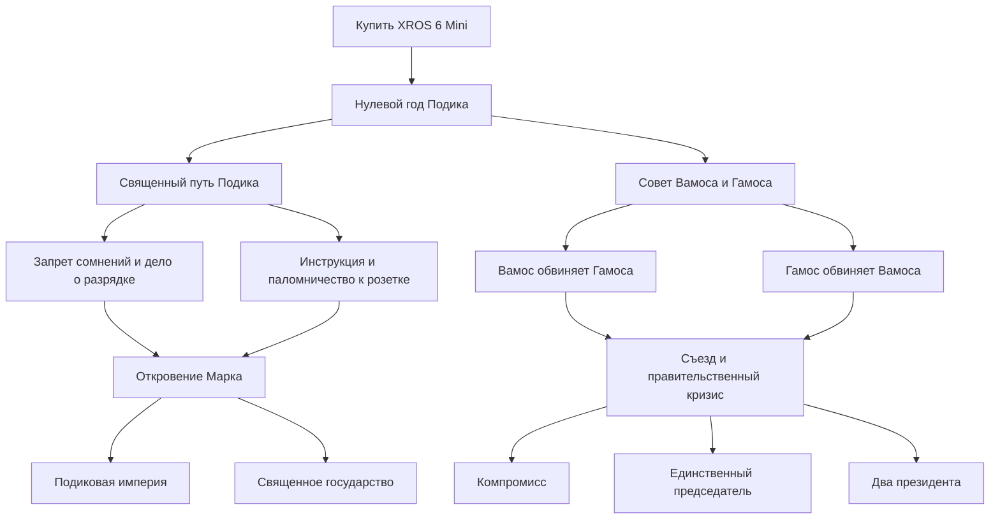

# Подиковая республика: реализация и проверка

Страна B11, столица в регионе 66; дипломатический партнёр — существующая B09, Гродненская республика президента Артура Круглого. Теги, территории, флаги и портрет Марка сохранены. Дерево содержит **101 фокус**, **101 событие**, **53 национальных духа**, **33 решения** в **6 категориях** и **6 модификаторов отношений**. Нужна новая партия, чтобы применились начальные технологии, персонажи и переменные.

## Политическая история

Старт: последнее здравомыслие → розыск Подика → чрезвычайный кабинет → кризис бюджета → покупка XROS 6 Mini → новая эпоха. Покупка даёт дух, переменную заряда, решения и отдельное историческое событие. Продолжительность фокусов — 7, 14, 21, 35 или 70 дней: `cost` в HOI4 измеряется неделями.

Культ и Совет строго взаимоисключаются. Культ делает Марка хранителем святыни, меняет правящую партию и отменяет выборы. Совет передаёт власть коллективному руководству и также меняет политический строй.

В культе оба ранних направления — религиозное и хозяйственное — нужны для объединения народа. Затем запрет сомнений исключает техническую инструкцию. Обе развилки сходятся у испарительной революции. Для назначения штатного пророка нужно признать откровение; отказ можно пересмотреть через повторное событие. Империя и верховенство Подика исключают друг друга.

В Совете нужно выслушать обоих председателей. Взаимные обвинения образуют альтернативную развилку; съезд доступен после любого обвинения. После кризиса выбирается ровно один из трёх финалов. Единоличное кресло требует не менее 65% влияния у одного председателя; лидером становится именно он.

| Финал | Изменения и возможности |
| --- | --- |
| Подиковая империя | Новое название, имперский дух, военное снабжение и цели войны против независимых соседей вне своего альянса. Дружественное Гродно исключено. |
| Священное государство | Новое название, устойчивость режима, священные собрания за политическую власть и заряд. |
| Великий компромисс | Прекращение борьбы влияний и саботажа, баланс 50/50, гражданские строительные контракты. |
| Единственный председатель | Вамос или Гамос становится реальным лидером, влияние 100/0, прекращение соперничества, военные производственные распоряжения. |
| Два президента | Коллективный лидер, новые бонусы и президентские смены; влияние и риск саботажа сохраняются. |

## Заряд и борьба за влияние

`KOCH_podik_charge` ограничен диапазоном 0–100 и меняется ежедневно. Базовый расход — 0,5 пункта в сутки, после инструкции — 0,3. Война добавляет 0,2, экономрежим уменьшает расход на 0,2 (минимум 0,1). Экономрежим стоит 10 политической власти при включении и даёт небольшие штрафы авторитета и поддержки войны; выключается бесплатно.

| Заряд | Состояние |
| --- | --- |
| От 90% | Золотой век: бонусы стабильности и строительства |
| 40–89,9% | Нормальная работа |
| 20–39,9% | Предупреждение и небольшой штраф политической власти |
| Ниже 20% | Кризис доверия; для восстановления порядка требуется 40% |
| 0% | Полное отключение: усиленный штраф вместо обычного кризиса |

Ручная зарядка стоит 20 политической власти, длится до трёх ежедневных обновлений и восстанавливает по 20 пунктов за обновление или по 30 после инструкции. Расход на время зарядки приостановлен, повторное подключение во время зарядки недоступно. При достижении 100% процесс завершается досрочно. Интервал между ручными заказами — 21 день. Срочная замена картриджа за 60 политической власти сохраняет немедленное восстановление 100% при заряде ниже 25%.

После инструкции можно назначить дежурного за 60 политической власти. Служба стоит 0,15 политической власти в день и автоматически начинает зарядку ниже 35%, без повторной оплаты каждого цикла. Службу можно отключить бесплатно; текущий цикл завершится. Повторная организация службы снова требует 60 политической власти. Поломки и пропажи автоматика не устраняет.

В панели решений показываются заряд с десятичной частью, состояние, режим, текущий расход, обслуживание и примерный срок до отметки 20%. Во время зарядки вместо прогноза показывается оставшееся время. До выбора культа расход не действует; Совет не использует эту механику. Предупреждение ниже 40% повторяется только после восстановления хотя бы до 60%, кризис — после выхода на 40%, отключение — после восстановления хотя бы до 20%.

Раз в месяц возможны редкие пропажа или поломка: по 3%, с общим перерывом 180 дней после происшествия. При происшествии заряд обнуляется, текущая зарядка прекращается. Розыск, срочный и прямой ремонт и покупка замены сохранены. Недоступное устройство нельзя зарядить ни вручную, ни автоматически; поздний результат розыска не сбрасывает заряд уже заменённого устройства.

`KOCH_vamos_influence` и `KOCH_gamos_influence` всегда дают в сумме 100. Решения поддержки меняют баланс на 10 пунктов, события могут менять его сильнее. При влиянии одного председателя не менее 75% ежемесячная проверка вызывает саботаж второго. Игрок может оплатить восстановление 50/50, переждать 90 дней остановок или уступить часть влияния с 30 днями ограниченного саботажа. Компромисс и единоличное правление прекращают эту механику; двоевластие сохраняет её. Отдельный редкий скандал возможен раз в месяц с вероятностью 6% и перерывом 180 дней.

## Артур и хозяйственная ветка

Дружба и конфронтация взаимоисключаются. Точное название **«Охранять туз Артура»** сохранено. Сначала предложение получает Артур; без его согласия охрана и дальнейшие договоры не открываются. Финансирование повышает шанс согласия ИИ. Отказ можно пересмотреть новым предложением через решения.

После согласия доступны взаимные гарантии, братство, хозяйственный саммит и предложение альянса. Союз требует независимости и совместимых обязательств; сначала создаётся фракция, затем в неё добавляется B09. Отказ Артура или несовместимые обязательства оставляют гарантии и возможность повторить предложение. Культ и Совет отличаются текстами, стоимостью ритуальной дипломатии и шансом одобрения союзного договора.

Конфронтация ухудшает отношения и запускает ультиматум с ответом Артура. После отказа можно отдельно получить цель войны за 75 политической власти либо примириться. Автоматического объявления войны нет. Успешные переговоры снимают пограничную горячку; следующий фокус не возвращает её после закрытия спора. При отсутствии B09 дипломатические фокусы недоступны, адресные эффекты защищены проверками существования страны.

Хозяйственная ветка зависит от новой эпохи и выбора политического курса, поэтому отсутствие Гродно не блокирует развитие. Она даёт логистику, завод, реальные ополчение и шаблон дивизии, опыт армии, пропаганду, исследовательскую группу и итоговый государственный дух. Культ получает строительные программы и заряд, Совет — производственные контракты и политическую власть. Ранние награды ограничены: несколько заводов и небольшое ополчение вместо мгновенной сверхдержавы.

Политика размещена слева и в центре, дипломатия — правее, хозяйственная колонка вынесена ещё дальше вправо, чтобы её длинная входящая связь не проходила через дипломатический корень. Панель непрерывных фокусов находится на `y = 3000`, ниже всего дерева. Использованы существующие тематические иконки HOI4. Вамос и Гамос используют разные базовые гражданские портреты; коллективный портрет Совета собран из этих же изображений.

## Файлы

| Файл | Назначение |
| --- | --- |
| `common/national_focus/koch_podik.txt` | 58 фокусов, координаты, условия, финалы и награды |
| `events/koch_podik.txt` | 50 сюжетных, дипломатических и кризисных событий |
| `common/ideas/koch_podik.txt` | 36 духов |
| `common/decisions/koch_podik.txt` | 25 решений, включая адресный имперский мандат |
| `common/decisions/categories/koch_podik.txt` | 4 категории и счётчики переменных |
| `common/scripted_effects/koch_podik.txt` | Инициализация, заряд, влияние, альянс и переходы власти |
| `common/on_actions/koch_podik.txt` | Стартовые, ежедневные и ежемесячные обработчики |
| `common/scripted_localisation/koch_podik.txt` | Состояние, режим, обслуживание и прогноз заряда |
| `common/opinion_modifiers/koch_podik.txt` | 6 дипломатических модификаторов |
| `common/country_leader/koch_podik_traits.txt` | Черты хранителя и пророка |
| `common/characters/koch_B11.txt` | Марк, Совет, Вамос и Гамос |
| `history/countries/B11 - koch.txt` | Начальные технологии, исследования, персонажи и кризис |
| `history/units/KOCH_B11_militia.txt` | Шаблон и дивизия ополчения |
| `gfx/leaders/B11/koch_council.dds` | Составной портрет Совета |
| `localisation/russian/koch_podik_l_russian.yml` | Названия, описания, события, решения, духи, финалы и подсказки; UTF-8 BOM |
| `localisation/russian/koch_countries_l_russian.yml` | Название и справка B09 |
| `localisation/english/koch_countries_l_english.yml` | Название и справка B09 на английском |
| `tools/build-podik-events.py` | Воспроизводимая сборка событий и их русских текстов |
| `tools/build-podik-localisation.py` | Сборка вспомогательной русской локализации |
| `tools/podik_tooltips.py` | Читаемые условия доступности и их русские подписи |
| `tools/validate-podik.py` | Структурная и механическая проверка |
| `tools/diagnostics/podik-completed/` | Журналы загрузки и итог проверки |
| `README.md`, `docs/podik-republic.md` | Документация |

Генераторы запускаются из корня мода: сначала `python tools/build-podik-events.py`, затем `python tools/build-podik-localisation.py`. Они не переписывают фокусы. Старые `configure-b09-b11.py` и `clear-world.ps1` — первоначальные установочные скрипты, их повторный запуск может сбросить последующие изменения.

## Проверка

`python tools/validate-podik.py` проверяет синтаксическую структуру с повторяющимися ключами, уникальность ID, ссылки и направление зависимостей, симметрию взаимоисключений, все десять сочетаний политических развилок, длительности, координаты и длинные вертикальные связи. Также проверяются события, духи, модификаторы отношений, категории, русский текст, BOM, определения иконок и существование портретов. Модель выполняет реальные блоки переменных из скриптов: дробные пороги заряда, восемь сочетаний расхода, трёхдневную зарядку, досрочное завершение, автоматику на 400 дней, отсутствие спама событий, отключение, восстановление, совместимость старых переменных, статусы панели, признание Марка и условия саботажа. Это проверка скриптов, а не симуляция полного движка HOI4.

До переработки разрядки был проведён реальный запуск установленной HOI4 1.19.3.0 с включённым модом. `setup.log` подтвердил загрузку 48 событий, 32 духов, 21 решения, 4 категорий, 6 модификаторов отношений, 2 черт и 3 обработчиков. В `error.log` не обнаружено ошибок файлов и идентификаторов Подиковой республики. В общем моде остаются посторонние ошибки базового контента, ссылающегося на удалённые страны: это не проверка глобальной безошибочности мода.

Проверка интерфейса была остановлена пользователем клавишей Escape до осмотра новой партии. Полное прохождение, вид дерева в текущей версии, поведение ИИ и дипломатические ответы в кампании не проверены. Последние изменения координат и портретов проверены по файлам после запуска, но ещё не осмотрены в игровом интерфейсе.

Переработка разрядки от 11 октября 2026 проверена структурным валидатором и выполнением блоков DSL; новая версия не загружалась в движок, поскольку игра пользователя уже запущена. Результат сохранён в `tools/diagnostics/podik-charge-rework/validation.txt`. Для применения нужно перезапустить HOI4, существующее сохранение можно продолжить: текущий заряд не сбрасывается, новые счётчики заполняются следующим ежедневным обновлением.

Для полной ручной проверки нужны партии за B11: культ с обеими политиками заряда и двумя финалами, Совет с тремя финалами и победой каждого председателя, согласие/отказ Артура, потеря устройства и его восстановление. Консольный вызов `event KOCH_PODIK.11024 B11` сам по себе не выставляет флаг пропажи: для корректного теста состояние нужно создать соответствующим эффектом или дождаться ежемесячного происшествия.

## Список фокусов

Исправление подсказок от 11 октября 2026: условия решений и фокусов получили явные русские подписи, включая отрицательные проверки поломки и пропажи. Внутренний пересчёт заряда скрыт от предпросмотра, который не учитывает предыдущие присваивания переменных и ошибочно обещал удалить «Золотой век» после зарядки. Решения теперь явно показывают расход или восстановление заряда. Проверены граница доступности замены картриджа, запреты при поломке/пропаже и фактическое восстановление 100% с золотым веком и снятием беспорядков. Проверка выполнена по скриптам; игра пользователя не перезапускалась. Новая партия для этого исправления не требуется.

В таблице `+` означает выполнение всех отдельных блоков предпосылок; `/` — выбор любого фокуса внутри одного блока. Временные условия и согласие Артура дополнительно проверяются в игре.

| ID | Название | Дни | Предпосылки |
| --- | --- | --- | --- |
| `KOCH_B11_LAST_SENSE` | Последняя затяжка здравого смысла | 7 | — |
| `KOCH_B11_WHERE_PODIK` | Где подик, господа министры? | 14 | LAST_SENSE |
| `KOCH_B11_EMERGENCY_LIQUID` | Кабинет на сухом остатке | 21 | WHERE_PODIK |
| `KOCH_B11_ONE_CARTRIDGE_BUDGET` | Казна на донышке | 35 | EMERGENCY_LIQUID |
| `KOCH_B11_BUY_XROS` | Купить XROS 6 Mini | 35 | ONE_CARTRIDGE_BUDGET |
| `KOCH_B11_NEW_EPOCH` | Нулевой год Подика | 14 | BUY_XROS |
| `KOCH_B11_PODIK_PATH` | Священный путь Подика | 35 | NEW_EPOCH |
| `KOCH_B11_COUNCIL_PATH` | Совет Вамоса и Гамоса | 35 | NEW_EPOCH |
| `KOCH_B11_PODIK_EVERYTHING` | Подик — наше всё | 35 | PODIK_PATH |
| `KOCH_B11_MASS_WORSHIP` | Явка на поклон — 146% | 35 | PODIK_EVERYTHING |
| `KOCH_B11_SACRED_CARTRIDGE` | Мощи с гарантией | 35 | MASS_WORSHIP |
| `KOCH_B11_MINISTRY_VAPOR` | Министерство жижи и пара | 70 | PODIK_EVERYTHING |
| `KOCH_B11_ONE_PEOPLE_ONE_PODIK` | Один народ, один Подик | 35 | SACRED_CARTRIDGE + FIRST_FIVE_YEAR |
| `KOCH_B11_FIRST_FIVE_YEAR` | Пятилетка до обеда | 70 | MINISTRY_VAPOR |
| `KOCH_B11_BAN_DOUBT` | Процентам верить запрещено | 35 | ONE_PEOPLE_ONE_PODIK |
| `KOCH_B11_PILGRIMAGE_CHARGER` | Все дороги ведут к розетке | 35 | SACRED_MANUAL |
| `KOCH_B11_SACRED_MANUAL` | Евангелие от техподдержки | 35 | ONE_PEOPLE_ONE_PODIK |
| `KOCH_B11_EMPTY_TREASON` | Ноль процентов — высшая мера | 35 | BAN_DOUBT |
| `KOCH_B11_EVAPORATION_REVOLUTION` | Революция без проветривания | 70 | EMPTY_TREASON / PILGRIMAGE_CHARGER |
| `KOCH_B11_MARK_HEARS_CARTRIDGE` | Картридж вызвал Марка | 35 | EVAPORATION_REVOLUTION |
| `KOCH_B11_MARK_PROPHET` | Пророк на полной ставке | 35 | MARK_HEARS_CARTRIDGE |
| `KOCH_B11_ETERNAL_EMPIRE` | Вечная Подиковая империя | 70 | MARK_PROPHET |
| `KOCH_B11_PODIK_ABOVE_STATE` | Подик выше государства | 70 | MARK_PROPHET |
| `KOCH_B11_TWO_CHAIRS` | Два стула — один Совет | 35 | COUNCIL_PATH |
| `KOCH_B11_VAMOS_SAID` | Вамос сказал Vamos | 21 | TWO_CHAIRS |
| `KOCH_B11_GAMOS_AGAINST` | Гамос против заранее | 21 | TWO_CHAIRS |
| `KOCH_B11_SPLIT_POWER` | Власть распилить вдоль | 35 | VAMOS_SAID + GAMOS_AGAINST |
| `KOCH_B11_MINISTRY_NONDECISIONS` | Ведомство «Потом разберёмся» | 35 | SPLIT_POWER |
| `KOCH_B11_COMMISSION_COMMISSION` | Комиссия по комиссиям | 70 | MINISTRY_NONDECISIONS |
| `KOCH_B11_WHO_IS_BOSS` | Кто здесь самый временный? | 35 | COMMISSION_COMMISSION |
| `KOCH_B11_NAPKIN_CONSTITUTION` | Конституция с пятном борща | 35 | WHO_IS_BOSS |
| `KOCH_B11_BAN_OUR_OPPOSITION` | Самих себя — под запрет | 35 | NAPKIN_CONSTITUTION |
| `KOCH_B11_VAMOS_BLAMES` | Дело о вредительстве Гамоса | 21 | BAN_OUR_OPPOSITION |
| `KOCH_B11_GAMOS_BLAMES` | Вамос, это всё ты | 21 | BAN_OUR_OPPOSITION |
| `KOCH_B11_TWO_PERSON_CONGRESS` | Съезд: оба на месте | 35 | VAMOS_BLAMES / GAMOS_BLAMES |
| `KOCH_B11_COUNCIL_CRISIS` | Бюджет пошёл в рукопашную | 35 | TWO_PERSON_CONGRESS |
| `KOCH_B11_GREAT_COMPROMISE` | Великий компромисс | 70 | COUNCIL_CRISIS |
| `KOCH_B11_SINGLE_CHAIR` | Единственный председатель | 70 | COUNCIL_CRISIS |
| `KOCH_B11_TWO_PRESIDENTS` | Государство двух президентов | 70 | COUNCIL_CRISIS |
| `KOCH_B11_DIPLOMATIC_ARGUMENT` | Артур: сосед или статья расходов? | 35 | NEW_EPOCH |
| `KOCH_B11_RELATIONS_GRODNO` | Посол с пакетом из дома | 14 | DIPLOMATIC_ARGUMENT |
| `KOCH_B11_PROTECT_ACE` | Охранять туз Артура | 35 | RELATIONS_GRODNO |
| `KOCH_B11_PACT_ACES` | Тузы под коллективной защитой | 35 | PROTECT_ACE |
| `KOCH_B11_BROTHERHOOD` | Побрататься без свидетелей | 35 | PACT_ACES |
| `KOCH_B11_ARTHUR_SUMMIT` | Артур, выйди на пять минут | 35 | BROTHERHOOD |
| `KOCH_B11_ONE_ALLIANCE_TWO_STATES` | Один союз, два алиби | 35 | ARTHUR_SUMMIT |
| `KOCH_B11_ACE_NOT_OUR_BUSINESS` | Туз Артура нас не касается | 14 | DIPLOMATIC_ARGUMENT |
| `KOCH_B11_DEEP_CONCERN` | Озабочены до самого дна | 21 | ACE_NOT_OUR_BUSINESS |
| `KOCH_B11_CONDEMN_ACE` | Тузу объявлен выговор | 35 | DEEP_CONCERN |
| `KOCH_B11_GRODNO_ULTIMATUM` | Артур, это последнее письмо | 35 | CONDEMN_ACE |
| `KOCH_B11_NOT_OUR_WAY` | Развод с видом на границу | 35 | GRODNO_ULTIMATUM |
| `KOCH_B11_EMERGENCY_LOGISTICS` | Скотч важнее генштаба | 35 | NEW_EPOCH |
| `KOCH_B11_CARTRIDGE_FACTORY` | Гособоронкартридж | 70 | EMERGENCY_LOGISTICS |
| `KOCH_B11_NATIONAL_MILITIA` | Кто в очереди — тот в строю | 35 | CARTRIDGE_FACTORY |
| `KOCH_B11_PROPAGANDA_CIRCUS` | Новости раньше событий | 35 | NATIONAL_MILITIA |
| `KOCH_B11_SCIENCE_OF_STUPIDITY` | Академия «А если вот так?» | 70 | PROPAGANDA_CIRCUS |
| `KOCH_B11_BORDER_COMMITTEE` | Учения «Кто там ходит?» | 35 | SCIENCE_OF_STUPIDITY |
| `KOCH_B11_FINAL_MEMO` | Просим считать это государством | 70 | BORDER_COMMITTEE |

## Расширение: принтер, балконы и Макафон

Реализовано 43 новых фокуса с сохранением всех 58 существующих ID. Наминал и Марк П — один персонаж `KOCH_B11_mark_p`, отображаемое имя — «Наминал (Марк П)». Мать Наминала — отдельный персонаж и доступный после мирного договора советник; использован существующий женский портрет игры. Тег B09 и точное название «Охранять туз Артура» сохранены.

### Мама и сломанный принтер

Четырнадцать фокусов: тайник → операция XROS → подозрение → проверка картриджей → требование распечатки → стратегический объект → обнаружение → три взаимоисключающих исхода → домашняя конституция. Сюжет фиксирует именно сломанный принтер как тайник XROS 6 Mini.

`KOCH_mother_suspicion` ограничено 0–100. До развязки растёт на 0,15 в день, зарядка без тихого режима добавляет 1 в день; литания, розыск и донос добавляют 10. Порог 70 даёт однократное предупреждение, 100 назначает проверку через 14 дней. Уборка и отвлекающая распечатка снижают подозрение на 20 с отдельными перерывами; тихая зарядка на 30 дней убирает прибавку от зарядки. Снижение ниже 85 после назначения проверки открывает бесплатный компромисс вместо обычной платы. Проверку также можно сознательно начать фокусом.

| Исход | Долгосрочный результат |
|---|---|
| Победа матери | Подик конфискован, культ подпольный; заряд сохранён, зарядка, обслуживание и все стадии штрафов за батарею приостановлены. Возврат за 50 политической власти однократен и не отменяет цену подполья. |
| Принтерная революция | Священная территория принтера; мать — Враг народа №1, гарантирована личная неприкосновенность. Поддержка войны растёт, стабильность снижается, домашняя холодная война требует содержания. |
| Договор с мамой | Заряд продолжает работать, домашние обязанности дают стабильность за небольшие постоянные расходы. |

Возврат восстанавливает сохранённый заряд и службу автоматической зарядки. Если устройство также сломано или пропало, возврат не чинит и не находит его. Обычные решения обслуживания при конфискации недоступны; ежемесячные пропажи/поломки не назначаются. Состояние видно в панели заряда. Существующий розыск/ремонт не превращён в бесплатную замену.

Совет может открыть частное досье на тайник отдельным однократным решением, затем донести на Наминала. Это позволяет реакции Совета влиять на семейный кризис при сохранении строгого взаимоисключения политических фокусов.

### Балконный вопрос и кладбище

Девять фокусов: государственный траур, расследование реакции государства, министерство, аудит ограждений, суд над тяготением, запрет балконов либо реальная программа перил, затем общая Балконная доктрина. Никаких обстоятельств гибели отца сверх падения с балкона не добавлено. Могила находится на кладбище «Секрет» в Гробно (Гродно). Юмор направлен на чиновничью реакцию и политическое использование трагедии.

Пять дипломатических фокусов добавляют запрос B09, посещение, скандал, договор о двух святынях и совместную церемонию. Артур получает настоящий запрос-событие. При отношениях ниже -25 первоначальное согласие недоступно без согласованной охраны; остаётся запрос ограниченного протокола. Отказ снимает ожидание и открывает повторное обращение либо платное согласование тихой делегации без оркестра. Ожидание запроса ограничено 30 днями. Отсутствующая B09 и война блокируют запросы; экономика и внутренние истории от B09 не зависят. Договор двух святынь требует и посещения, и согласия на охрану туза Артура. Автоматического объявления войны нет.

### Футболка, Макафон и Гамос

Восемь фокусов футболки включают полный «Великий разрыв»: Вамос пытается разорвать футболку и обсирается, футболка остаётся целой. Четыре ответа имеют разные последствия: пропаганда, обвинение Гамоса, секретность записи, смена штанов. Далее Гамос скрывает запись за полномочия, публикует её, обвиняет иностранную прачечную или уничтожает копии ради Совета. Влияние меняется от -30 до +20 в зависимости от действия. Вторая демонстрация — добровольная альтернатива амнистии текстильщиков, с более тяжёлыми последствиями. Финал закрывает временный Коричневый кризис, сохраняя изменения влияния.

В девяти фокусах Макафона последовательно возникают запрос информации, проверка исправности аппарата, отсутствие сведений, пресс-конференция без слов и перехват пустого канала. Три взаимоисключающих ответа: архив молчания под контролем Гамоса, молчализм с усилением Вамоса либо переворот Гамоса. При перевороте Гамос действительно становится временным лидером и получает 80 влияния. После уже завершённого конституционного урегулирования событие даёт парламентское расследование, сохраняя выбранный режим. Все старые финалы Совета доступны, снимают временный дух регентства и назначают соответствующего лидера. Отложенная запись футболки не меняет победителя окончательного единоличного режима. Влияния всегда дополняют друг друга до 100.

### Десять скрытых событий

Условия проверяются ежемесячно, не более одного нового события в месяц; каждое имеет свой флаг однократности. Они не ломают и не конфискуют подик.

| Событие | Особое условие |
|---|---|
| Мама купила новый принтер | Начат тайник, куплен тонер, семейный кризис ещё не завершён. |
| Принтер неожиданно заработал | Пройдено требование распечатки, подозрение выше 49, кризис ещё открыт. |
| Вамос наконец заговорил | Финал Макафона и решение продолжать ждать редкий ответ. Сказал «Нет». |
| Срочное обращение к нации | Длительная трансляция и пресс-конференция без слов: семь часов тишины. |
| На кладбище закончились места | Согласованное посещение «Секрета»; выясняется, что кончились строки в бланке. |
| Наминал потерял картридж | Священный картридж и завершённая домашняя конституция. Пропал запасной, устройство работает. |
| Ньютон подал апелляцию | Заочный приговор Ньютону и Балконная доктрина. |
| Макафон запросил отпуск | Финал Макафона с архивом несуществующей информации. |
| Картридж с дипломатическим иммунитетом | Договор двух святынь и священный картридж. |
| Футболка пережила два правительства | Вторая демонстрация и закрытое дело футболки. |

### Старые фокусы и оформление

Четыре старых фокуса получили дополнительные события с выбором: чрезвычайный кабинет, Министерство пара, комиссия по комиссиям и Академия глупости. Все прежние сюжетные события, финалы, заряд, кризисы и решения сохранены. Новые ветки имеют отдельные колонки: балконы, мама, культ, основной Совет, футболка, Макафон, дипломатия, экономика. Ни одна проверенная входящая линия не проходит через значок другого фокуса; непрерывные фокусы остаются ниже дерева. Для фокусов, событий и духов использованы найденные в установленной игре изображения.

Схема реальных координат: [focus-layout.png](../tools/diagnostics/podik-expansion/focus-layout.png). Это схема скриптов, не скриншот игры.

### Проверка расширения

`python tools/validate-podik.py` успешно проверил 101 фокус, 101 событие, 53 духа, 33 решения, 6 категорий, русскую локализацию с BOM и существование всех использованных GFX. Проверены 192 сочетания развилок с правильными OR-слияниями, предупреждение матери и задержка проверки, все исходы, 200 дней конфискации на четырёх уровнях заряда, возврат сломанного/пропавшего устройства без ремонта, разные ответы футболочного скандала, временное руководство Гамоса, защита окончательного лидера, запрос к отсутствующей/воюющей B09, отказ и мирный протокол, десять однократных секретов. Существующие проверки ежедневного заряда и влияния тоже проходят.

11 октября 2026 года выполнен отдельный запуск установленного HOI4 1.19.3.0 с включённым модом. `setup.log` подтверждает загрузку `events/koch_podik.txt` с 101 событием и трёх обработчиков `on_actions`; движок завершил startup. В `error.log` этого запуска не найдено строк про `koch_podik`, `KOCH_PODIK`, `KOCH_B11` или `koch_B11`. Общие старые ошибки мода про удалённые ванильные страны и некоторые здания остались; исправление всего мода не заявляется. Диагностический процесс был запущен и остановлен этой задачей, пользовательская партия не использовалась. Полное интерактивное прохождение новых цепочек не проводилось.

Журналы и результат модели: `tools/diagnostics/podik-expansion/`. Для полной проверки персонажа матери, дерева и стартовых данных рекомендуется новая партия. Уже существующий заряд не сбрасывается ежедневной инициализацией.

Пересборка: `python tools/install-podik-expansion.py`, затем `python tools/build-podik-events.py`, затем `python tools/build-podik-localisation.py`, затем `python tools/validate-podik.py`. Схему обновляет `python tools/render-podik-layout.py`.

### Новые фокусы

| ID | Название | Дни | Предшественник (через / — OR) |
|---|---|---:|---|
| `KOCH_B11_DEAD_PRINTER` | Принтер давно не печатает | 21 | PODIK_PATH |
| `KOCH_B11_PRINTER_CACHE` | Идеальный тайник с гарантией | 21 | DEAD_PRINTER |
| `KOCH_B11_OPERATION_XROS` | Операция «Не трогай, сломано» | 21 | PRINTER_CACHE |
| `KOCH_B11_MOTHER_SUSPECTS` | Мама что-то подозревает | 21 | OPERATION_XROS |
| `KOCH_B11_SEALED_LID` | Крышка под государственной печатью | 21 | MOTHER_SUSPECTS |
| `KOCH_B11_CARTRIDGE_INSPECTION` | Великая проверка картриджей | 21 | SEALED_LID |
| `KOCH_B11_PRINT_DOCUMENT` | Распечатай мне одну бумажку | 14 | CARTRIDGE_INSPECTION |
| `KOCH_B11_PRINTER_STRATEGIC` | Объект особой бесполезности | 35 | PRINT_DOCUMENT |
| `KOCH_B11_SHE_FOUND_IT` | Она открыла крышку | 21 | PRINTER_STRATEGIC |
| `KOCH_B11_MATERNAL_CONTROL` | Победа материнского контроля | 35 | SHE_FOUND_IT |
| `KOCH_B11_PRINTER_REVOLUTION` | Принтерная революция | 35 | SHE_FOUND_IT |
| `KOCH_B11_MOTHER_TREATY` | Договор с мамой на холодильнике | 35 | SHE_FOUND_IT |
| `KOCH_B11_HOUSEHOLD_CONSTITUTION` | Конституция двухкомнатной державы | 35 | MATERNAL_CONTROL / PRINTER_REVOLUTION / MOTHER_TREATY |
| `KOCH_B11_NATIONAL_MOURNING` | Личное горе, государственный бланк | 21 | NEW_EPOCH |
| `KOCH_B11_BALCONY_QUESTION` | Балконный вопрос | 21 | NATIONAL_MOURNING |
| `KOCH_B11_FALLING_MINISTRY` | Министерство недопущения падений | 35 | BALCONY_QUESTION |
| `KOCH_B11_AUDIT_BALCONIES` | Проверить все балконы. Кроме нашего | 21 | FALLING_MINISTRY |
| `KOCH_B11_GRAVITY_TRIAL` | Суд над всемирным тяготением | 35 | AUDIT_BALCONIES |
| `KOCH_B11_BAN_BALCONIES` | Балконов больше не будет | 35 | GRAVITY_TRIAL |
| `KOCH_B11_SAFE_RAILINGS` | Перила сильнее резолюций | 35 | GRAVITY_TRIAL |
| `KOCH_B11_BALCONY_DOCTRINE` | Балконная доктрина | 35 | BAN_BALCONIES / SAFE_RAILINGS |
| `KOCH_B11_GROBNO_EXPEDITION` | Экспедиция в Гробно | 21 | DIPLOMATIC_ARGUMENT |
| `KOCH_B11_SECRET_CEMETERY` | Кладбище «Секрет» | 21 | GROBNO_EXPEDITION |
| `KOCH_B11_GRAVESIDE_PROTOCOL` | Скандал у могилы | 14 | SECRET_CEMETERY |
| `KOCH_B11_TWO_SHRINES` | Договор о защите двух святынь | 35 | GRAVESIDE_PROTOCOL |
| `KOCH_B11_JOINT_REMEMBRANCE` | Без оркестра тоже считается | 35 | TWO_SHRINES |
| `KOCH_B11_LAST_SHIRT` | Последняя футболка Республики | 21 | COUNCIL_PATH |
| `KOCH_B11_GREAT_RIP` | Подготовить Великий разрыв | 14 | LAST_SHIRT |
| `KOCH_B11_BROWN_COMMISSION` | Комиссия по запаху власти | 21 | GREAT_RIP |
| `KOCH_B11_GAMOS_TAPE` | У Гамоса есть копия | 21 | BROWN_COMMISSION |
| `KOCH_B11_TROUSER_RESERVE` | Стратегический резерв штанов | 35 | GAMOS_TAPE |
| `KOCH_B11_SECOND_DEMONSTRATION` | Теперь точно порвётся | 21 | TROUSER_RESERVE |
| `KOCH_B11_TAILOR_AMNESTY` | Амнистия для текстильной отрасли | 21 | TROUSER_RESERVE |
| `KOCH_B11_SHIRT_HISTORY` | История, которую отстирали | 35 | SECOND_DEMONSTRATION / TAILOR_AMNESTY |
| `KOCH_B11_GIVE_INFO` | Вамос, дай инфу | 21 | COUNCIL_PATH |
| `KOCH_B11_MAKAFON_ON` | Макафон включён | 14 | GIVE_INFO |
| `KOCH_B11_NO_INFORMATION` | Секретная информация отсутствует | 21 | MAKAFON_ON |
| `KOCH_B11_WORDLESS_PRESS` | Пресс-конференция без слов | 21 | NO_INFORMATION |
| `KOCH_B11_GAMOS_INTERCEPT` | Перехватить пустой канал | 21 | WORDLESS_PRESS |
| `KOCH_B11_SILENCE_SECRET` | Гриф «совершенно нечего сообщить» | 35 | GAMOS_INTERCEPT |
| `KOCH_B11_SILENCE_IDEOLOGY` | Молчализм как государственная идея | 35 | GAMOS_INTERCEPT |
| `KOCH_B11_GAMOS_COUP` | Переворот без звукового сопровождения | 35 | GAMOS_INTERCEPT |
| `KOCH_B11_VOICE_THAT_WASNT` | Голос, которого не было | 35 | SILENCE_SECRET / SILENCE_IDEOLOGY / GAMOS_COUP |
